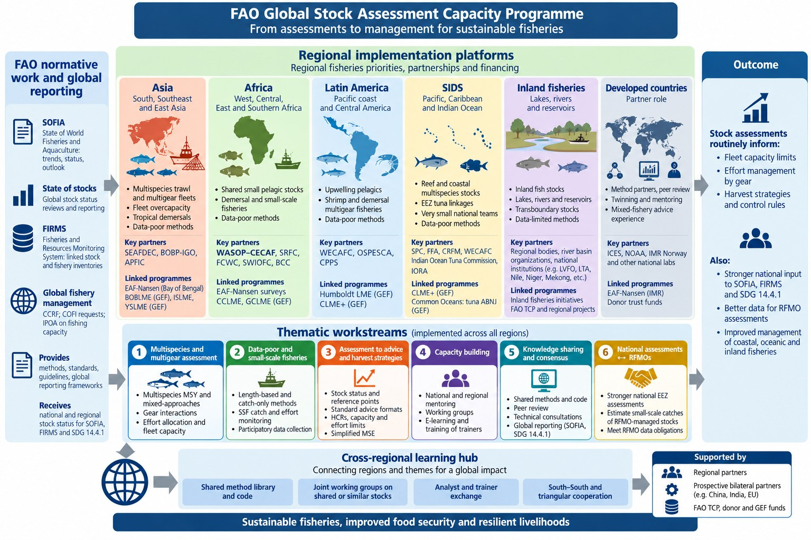

::: {.callout-important appearance="simple"}
**Development version.** *NFIFM Toolbox* is a working title for the shared method library of the FAO Global Stock Assessment Capacity Programme. Content is draft and not an official FAO product.
:::

## Part of the Global Stock Assessment Capacity Programme

{fig-alt="Diagram of the FAO Global Stock Assessment Capacity Programme: FAO normative work and global reporting (SOFIA, State of stocks, FIRMS, global fishery management) on the left; six regional implementation platforms (Asia, Africa, Latin America, SIDS, inland fisheries, developed countries as partners) across the top; six thematic workstreams across all regions in the middle; the cross-regional learning hub with a shared method library and code at the bottom; and outcomes for fleet capacity, effort management and harvest strategies on the right." .lightbox}

The programme links FAO's normative work and global reporting with **regional implementation platforms** and six **thematic workstreams**, so that stock assessments routinely inform fleet capacity limits, effort management and harvest strategies. Its **cross-regional learning hub** connects regions and themes. The toolbox is the hub's **shared method library and code**: the common place where methods, data tools, guidance and training material are documented once and used by every region.

### Where the toolbox fits

| Programme element | What the toolbox provides |
|---|---|
| **Cross-regional learning hub:** shared method library and code | The whole toolbox: [data preparation](data-tools/index.qmd), [method selector](select/index.qmd), [method catalogue](methods/index.qmd), [fishery indicators](methods/empirical/index.qmd), [advice and harvest strategies](advice/index.qmd) |
| Joint working groups; analyst and trainer exchange | [Training and apps](training/index.qmd), with the Stock Monitoring Tool as the main training environment; shared [case studies](regions/index.qmd) |
| **Regional implementation platforms** | [Regional hubs](regions/index.qmd) that add their own case studies and priorities (first: [CECAF assessment catalogue](https://henning-winker.github.io/cecaf-assessment-catalogue)) |
| **Thematic workstreams 1–6** | Entry points by workstream (below) |
| **FAO normative work and global reporting** (SOFIA, FIRMS, SDG 14.4.1) | Common [principles](framework/principles.qmd), [model acceptance criteria](guidance/diagnostics.qmd#model-acceptance-checklist) and [misuse prevention](guidance/misuse.qmd), so that status reported from different regions and data tiers is comparable |
| Developed-country partners: method partners and peer review | Contributions through GitHub review and a proposed expert review panel |

Every method is documented the same way. Each page follows the pipeline **data → method → outputs**, with diagnostics, sensitivity demos, worked examples and code, and an explicit **use and misuse** section: when *not* to use the method, pre-run checks, and the checks to pass before results are used for advice.

## Philosophy

The toolbox follows a **[hierarchical assessment framework](framework/principles.qmd)**: one assessment logic and one set of biological assumptions across the data ladder, from length data only to catch, length and abundance indices; **risk-equivalent** advice whichever tier a stock is assessed at; and the **value of information** of each data source measured in simulated and real case studies.

## From data to advice

::: {.path}
[1 · Prepare data](data-tools/data-preparation.qmd) [→]{.arrow} [2 · Select methods](select/index.qmd) [→]{.arrow} [3 · Assess](methods/index.qmd) [→]{.arrow} [4 · Diagnose and check for misuse](guidance/diagnostics.qmd) [→]{.arrow} [5 · Advice and HCRs](advice/index.qmd)
:::

Start by [preparing and inventorying the data](data-tools/data-preparation.qmd), then use the **[method selector](select/index.qmd)**: describe your data (catch, indices, length or age composition, life history, gears, fishery) and it lists the candidate methods, the data you would still need for others, and the misuse warnings for your situation.

## The toolbox by workstream

::: {.ws-grid}
::: {.ws-card style="--ws:#1f5fa8"}
[Workstream 1]{.ws-num}

#### [Multispecies and multigear assessment](methods/multispecies/index.qmd)
Multispecies MSY and mixed approaches, gear interactions, effort allocation and fleet capacity (mmsyFM).
:::
::: {.ws-card style="--ws:#2e7d4f"}
[Workstream 2]{.ws-num}

#### [Data-poor and small-scale fisheries](methods/dynamic-pool/index.qmd)
Length-based and catch-only methods, SSF catch and effort monitoring, participatory data collection.
:::
::: {.ws-card style="--ws:#c4552b"}
[Workstream 3]{.ws-num}

#### [Assessment to advice and harvest strategies](advice/index.qmd)
Stock status and reference points, standard advice formats, HCRs, capacity and effort limits, simplified MSE and participatory comparison of management options (FPAT).
:::
::: {.ws-card style="--ws:#6b4fa0"}
[Workstream 4]{.ws-num}

#### [Capacity building](training/index.qmd)
National and regional mentoring, working groups, e-learning, training of trainers, with the Stock Monitoring Tool as the main training environment.
:::
::: {.ws-card style="--ws:#0f7c86"}
[Workstream 5]{.ws-num}

#### [Knowledge sharing and consensus](contributing.qmd)
Shared methods and code, peer review, technical consultations, global reporting (SOFIA, SDG 14.4.1).
:::
::: {.ws-card style="--ws:#b7791f"}
[Workstream 6]{.ws-num}

#### [National assessments ↔ RFMOs](regions/index.qmd)
Stronger national EEZ assessments, small-scale catches of RFMO-managed stocks, RFMO data obligations.
:::
:::

## Regional platforms

The toolbox is shared across the regional implementation platforms (Asia, Africa, Latin America, SIDS, inland fisheries, with developed countries as partners); regional hubs add their own case studies, data and priorities. See [Regional hubs](regions/index.qmd). The first hub is the **[CECAF assessment catalogue](https://henning-winker.github.io/cecaf-assessment-catalogue)** (Africa, WASOP-CECAF).

## Showcase entries

Five entries are documented in full as examples of what every entry will eventually contain: data templates and preparation, the method and its software or app, outputs with diagnostics and sensitivities, use and misuse guidance, and worked examples.

| Entry | Pillar | No-code app |
|---|---|---|
| [FishualizeR](data-tools/fishualizer.qmd) | Data preparation | FishualizeR web app |
| [cpueTargeting](data-tools/cpuetargeting.qmd) | Data: CPUE standardisation | – |
| [FLicc](methods/dynamic-pool/flicc.qmd) | Assessment: length-based | Stock Monitoring Tool module (prototype) |
| [mmsyFM](methods/multispecies/mmsyfm.qmd) | Multispecies harvest strategies | mmsyFM Shiny app |
| [JABBA](methods/biomass-dynamic/jabba.qmd) (candidate) | Assessment: surplus production | Stock Monitoring Tool |

Other methods are **basic** entries, populated with the information available so far.

## Current status

```{r}
#| echo: false
source("R/toolbox.R")
m <- read_methods()
tab <- as.data.frame.matrix(table(factor(m$category, levels = c("Assessment", "Data and CPUE tools", "Advice and MSE")),
                                  factor(m$status, levels = c("basic", "draft", "reviewed"))))
tab <- cbind(Section = rownames(tab), tab,
             Showcase = as.vector(tapply(m$showcase != "", factor(m$category, levels = c("Assessment", "Data and CPUE tools", "Advice and MSE")), sum)))
rownames(tab) <- NULL
names(tab) <- c("Section", "Basic", "Draft", "Reviewed", "Showcase")
knitr::kable(tab)
```

Every page has **Edit this page** and **Report an issue** links (top right). Changes are proposed as pull requests and reviewed before they go live. See [Contributing](contributing.qmd).
