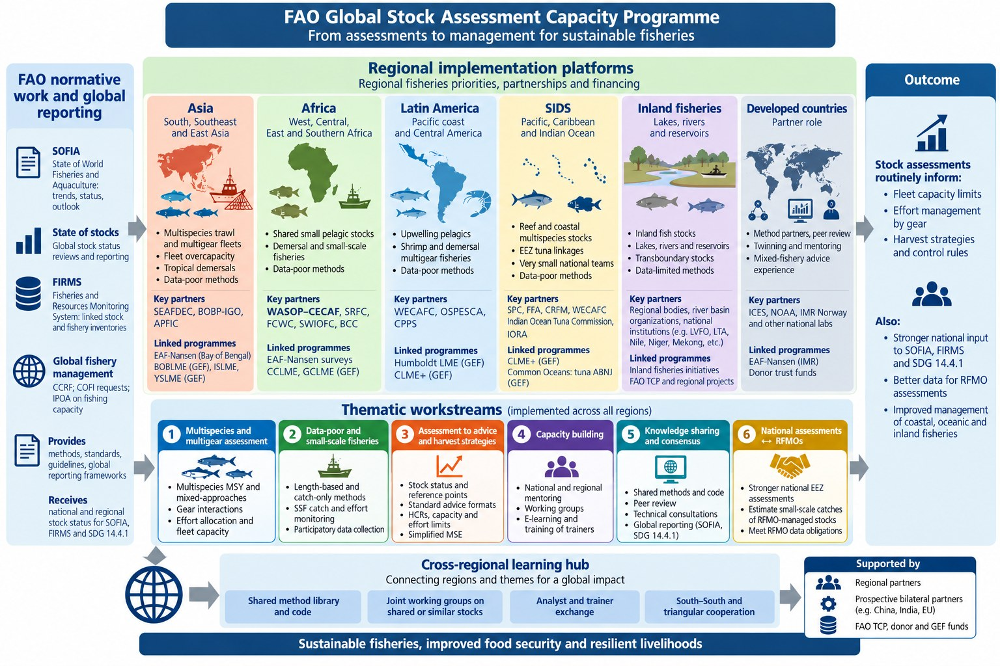

```{=html}
<div class="tbx">
<div class="hero"><h1>NFIFM Toolbox</h1>
<p class="lead">Shared method library and code for stock assessment, from data to management advice. The toolbox is part of the FAO Global Stock Assessment Capacity Programme.</p>
<div class="dev"><b>Development version.</b> NFIFM Toolbox is a working title for the shared method library of the programme. Content is draft and not an official FAO product.</div>
<div class="jump"><span class="label">On this page</span><a href="#programme">The programme</a><a href="#obj">Objectives</a><a href="#logic">One assessment logic</a><a href="#ws">Toolbox by workstream</a></div></div>

<div class="band" id="programme"><h2>The Global Stock Assessment Capacity Programme</h2>
<p class="sub">The programme links FAO's normative work and global reporting with regional implementation platforms and six thematic workstreams, so that stock assessments routinely inform fleet capacity limits, effort management and harvest strategies. Its cross-regional learning hub connects regions and themes, and the toolbox is the hub's shared method library and code.</p>
<div class="fig"><p class="cap">The FAO Global Stock Assessment Capacity Programme: from assessments to management for sustainable fisheries. The toolbox is the shared method library and code of the cross-regional learning hub (bottom).</p></div></div>

<div class="band tint" id="obj"><h2>Objectives of the toolbox</h2>
<p class="sub">The toolbox supports the programme's aim that stock assessments routinely inform management, and pursues four objectives. <span style="color:#7a5200">Objective wording is a draft for discussion.</span></p>
<div class="obj"><div class="oc" style="--c:#2273ae"><span class="on">1</span><h4>One shared method library</h4><p>Every method is documented once, in the same format (data, method, outputs, diagnostics, code, and use and misuse), so every region draws on the same material.</p></div><div class="oc" style="--c:#1d8a78"><span class="on">2</span><h4>Methods matched to data</h4><p>A method selector and a crosswalk of method attributes match methods to the data a stock has, and flag assumptions that its data may violate.</p></div><div class="oc" style="--c:#c27b1a"><span class="on">3</span><h4>Comparable, risk-equivalent advice</h4><p>Common principles and acceptance criteria make status from different regions and data tiers comparable for SOFIA, FIRMS and SDG 14.4.1.</p></div><div class="oc" style="--c:#6b4fa0"><span class="on">4</span><h4>Misuse prevented, capacity built</h4><p>Explicit misuse guidance on every page and no-code apps with worked examples help analysts apply methods within their assumptions.</p></div></div></div>

<div class="band" id="logic"><h2>One assessment logic for many data situations</h2>
<p class="sub">The toolbox is built on a hierarchical assessment framework (Kell <i>et al.</i>, 2025), in which one assessment logic and one set of biological assumptions apply whatever data exist. One tool family can work with length compositions, catches, abundance indices, and age data, so stocks assessed with very different data remain comparable within one larger toolbox, and advice carries equivalent risk at every level of data richness.</p>
<div class="lg"><div class="lgc"><div class="lgh">Many data situations</div><div class="lgl"><span style="--c:#c27b1a">Life history and exploitation history</span><span style="--c:#1d8a78">Length compositions, by gear</span><span style="--c:#2b7fb0">Catch</span><span style="--c:#4a67c0">Abundance indices</span><span style="--c:#6b4fa0">Catch-at-age and surveys</span></div></div>
<div class="lga">→</div>
<div class="lgc hub"><div class="lgh">One assessment logic</div><div class="hubt">One tool family with many capabilities</div><ul><li><b>Shared biology:</b> growth, mortality, maturity and selectivity defined once</li><li><b>Shared reference points</b> from one per-recruit model</li><li><b>Shared diagnostics</b> and model acceptance criteria</li></ul></div>
<div class="lga">→</div>
<div class="lgc"><div class="lgh">One comparable result</div><div class="lgl out"><span>Stock status on a common footing</span><span>Advice with equivalent risk at every level of data</span><span>Clear signals on which data would improve advice</span></div></div></div></div>

<div class="band tint" id="ws"><h2>Toolbox by workstream</h2>
<p class="sub">Each of the programme's six thematic workstreams is implemented across all regions. Each box below describes the workstream and links the tools and pages most relevant to it; tools can appear under several workstreams.</p>
<div class="wsg"><div class="ws" style="--c:#0356a6"><div class="wh"><span class="wn">1</span><div><small>Workstream 1</small><h4>Multispecies and multigear assessment</h4></div></div><div class="wb"><p>Multispecies MSY and mixed-fishery approaches, gear interactions, effort allocation and fleet capacity.</p><div class="lab">Relevant tools and pages</div><div class="chips"><a class="chip" href="methods/multispecies/mmsyfm.qmd">mmsyFM</a><span class="chip">FLicc multi-gear</span><span class="chip pl">Multispecies MSE tool <i>planned</i></span><a class="chip" href="methods/multispecies/index.qmd">Multispecies overview</a></div></div></div><div class="ws" style="--c:#2a8c46"><div class="wh"><span class="wn">2</span><div><small>Workstream 2</small><h4>Data-poor and small-scale fisheries</h4></div></div><div class="wb"><p>Length-based and catch-only methods, catch and effort monitoring for small-scale fisheries, and participatory data collection.</p><div class="lab">Relevant tools and pages</div><div class="chips"><a class="chip" href="methods/biomass-dynamic/cmsy.qmd">CMSY+</a><a class="chip" href="methods/dynamic-pool/flicc.qmd">FLicc</a><a class="chip" href="methods/dynamic-pool/lbspr.qmd">LBSPR</a><a class="chip" href="methods/dynamic-pool/lbb.qmd">LBB</a><a class="chip" href="methods/dynamic-pool/tropfishr.qmd">TropFishR</a><a class="chip" href="methods/empirical/index.qmd">Fishery indicators</a><a class="chip" href="data-tools/index.qmd">Data preparation</a><a class="chip" href="data-tools/fishualizer.qmd">FishualizeR</a><a class="chip" href="data-tools/cpuetargeting.qmd">cpueTargeting</a></div></div></div><div class="ws" style="--c:#e25e20"><div class="wh"><span class="wn">3</span><div><small>Workstream 3</small><h4>Assessment to advice and harvest strategies</h4></div></div><div class="wb"><p>Stock status and reference points, standard advice formats, harvest control rules, capacity and effort limits, and simplified MSE.</p><div class="lab">Relevant tools and pages</div><div class="chips"><a class="chip" href="advice/flref.qmd">FLRef</a><a class="chip" href="advice/mse.qmd">FLR mse</a><a class="chip" href="advice/fpat.qmd">FPAT App</a><span class="chip pl">FLOSS <i>planned</i></span><a class="chip" href="guidance/diagnostics.qmd">Diagnostics and validation</a><a class="chip" href="advice/index.qmd">Advice overview</a></div></div></div><div class="ws" style="--c:#64419c"><div class="wh"><span class="wn">4</span><div><small>Workstream 4</small><h4>Capacity building</h4></div></div><div class="wb"><p>National and regional mentoring, working groups, e-learning and training of trainers.</p><div class="lab">Relevant tools and pages</div><div class="chips"><a class="chip" href="training/smt.qmd">Stock Monitoring Tool</a><a class="chip" href="training/index.qmd">Training and apps</a><a class="chip" href="resources/installation.qmd">Installation guide</a><span class="chip">FLicc user guide</span></div></div></div><div class="ws" style="--c:#07788f"><div class="wh"><span class="wn">5</span><div><small>Workstream 5</small><h4>Knowledge sharing and consensus</h4></div></div><div class="wb"><p>Shared methods and code, peer review, technical consultations and global reporting (SOFIA, SDG 14.4.1).</p><div class="lab">Relevant tools and pages</div><div class="chips"><a class="chip" href="framework/principles.qmd">Principles</a><a class="chip" href="guidance/misuse.qmd">Misuse prevention</a><span class="chip">Model acceptance checklist</span><a class="chip" href="resources/literature.qmd">Methodological literature</a><a class="chip" href="contributing.qmd">Contribute</a></div></div></div><div class="ws" style="--c:#c99410"><div class="wh"><span class="wn">6</span><div><small>Workstream 6</small><h4>National assessments and RFMOs</h4></div></div><div class="wb"><p>Stronger national EEZ assessments, small-scale catches of RFMO-managed stocks, and RFMO data obligations.</p><div class="lab">Relevant tools and pages</div><div class="chips"><a class="chip" href="select/index.qmd">Method selector</a><a class="chip" href="methods/biomass-dynamic/jabba.qmd">JABBA</a><a class="chip" href="methods/biomass-dynamic/spict.qmd">SPiCT</a><a class="chip" href="methods/age-structured/age-structured.qmd">Age-structured models</a><a class="chip" href="regions/index.qmd">Regional hubs</a></div></div></div></div>
<div class="chips" style="margin-top:18px;align-items:center"><span class="label" style="margin-right:6px">Key</span><span class="chip">Available tool or page</span><span class="chip pl">Planned tool <i>planned</i></span></div></div>
</div>
```
