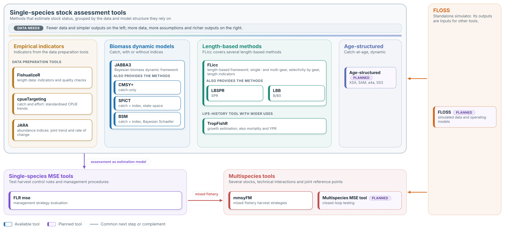

::::: {.column-screen}

```{=html}
<div class="tbx p-methods">
<div class="hero"><h1>Assessment methods<span class="pill">Draft</span></h1>
<p class="lead">Numerous stock assessment methods are available, and they differ in quality, in the data they require, and in how widely they are applied. The toolbox maps this landscape and provides a small set of well-documented FAO tools, supported with training, applications and manuals.</p>
<div class="jump"><span class="label">On this page</span><a href="#compare">Current and FAO tools</a><a href="#figure">Methods map</a><a href="#endorsed">FAO tools</a><a href="#regional">Regional methods</a><a href="#catalogue">Catalogue entries</a></div></div>
<div class="band" id="compare"><h2>Current tools and FAO tools</h2>
<p class="sub">Methods already in use have real strengths, and FAO tools add documentation and support. The comparison below sets out the trade-offs of each.</p><div class="cmp2">
<div class="cl"><div class="ch" style="background:#6b7a86"><small>Current practice</small><b>Established and regional tools</b><p>Methods already in use in countries and regions, many developed locally or over several decades.</p></div><div class="bd"><div class="pro"><h5>Strengths</h5><ul><li>Familiar to analysts and institutions, so teams can start without retraining</li><li>Long records of results support continuity of time series and comparison with past assessments</li><li>Already embedded in national and regional reporting routines</li><li>Suited to local fisheries and data where they were developed</li></ul></div><div class="con"><h5>Limitations</h5><ul><li>Documentation, assumptions and outputs vary, so results are hard to compare between countries</li><li>Some tools are older software with limited maintenance and limited treatment of uncertainty</li><li>Limited guidance on which data conditions suit each method</li><li>Training and support depend on individual institutes and a few experts</li></ul></div></div></div>
<div class="cl"><div class="ch" style="background:#0f766e"><small>Toolbox approach</small><b>FAO tools</b><p>A small set of tools the FAO toolbox recommends and supports with resources.</p></div><div class="bd"><div class="pro"><h5>Strengths</h5><ul><li>Documented, maintained and tested, with training materials, Shiny apps and manuals</li><li>Outputs are consistent and align with FAO stock status reporting</li><li>Tools are designed to connect, so the output of one can feed the next</li><li>Cover the main data situations, from catch-only to length-based and multispecies</li></ul></div><div class="con"><h5>Limitations</h5><ul><li>Adoption requires change from familiar tools and some retraining</li><li>Not every data situation is covered yet, for example age-structured models and simulation are planned</li><li>Results may differ from those of established methods during a transition</li><li>Apps and documentation need continuing support from the toolbox team</li></ul></div></div></div></div>
<p class="note">Neither group is wrong in itself. Established tools remain mapped in the figure below to show connections, and regional hubs discuss when to keep, extend or change them.</p></div>
<div class="band tint" id="figure"><h2>Methods map</h2><p class="sub">Tools can serve more than one purpose, so the figure groups them by main use. Arrows show where the output of one tool feeds another.</p>
<div class="figw"><a href="../assets/img/assessment-figure.png" target="_blank"></a></div><p class="figlk"><a href="../assets/img/assessment-figure.png" target="_blank">Open the figure at full size &#8599;</a></p></div>
<div class="band" id="endorsed"><h2>FAO tools</h2><p class="sub">Tools are grouped by main purpose. Each lists the data it needs, what it produces, and the resources available for it. JABBA3 provides CMSY+, SPiCT and BSM, and FLicc provides LBSPR and LBB; these, with TropFishR and the age-structured models, are documented under catalogue entries. Resource lists are provisional and are to be confirmed with the toolbox team.</p><div class="gh" style="--c:#c27a1a"><h3>Data preparation and empirical indicators</h3></div><div class="tg"><div class="tc" style="--c:#c27a1a"><div class="tn"><a href="../data-tools/fishualizer.qmd">FishualizeR</a><span>Data preparation</span></div><p>Inventory, quality control and exploratory analysis of fishery data.</p><dl><dt>Data</dt><dd>Length, catch and effort data</dd><dt>Output</dt><dd>Indicators and quality checks</dd></dl><div class="rs2"><b>Available resources</b><ul><li><a>Shiny app</a></li><li><a>Manual</a></li><li><a>Training materials</a></li></ul></div></div><div class="tc" style="--c:#c27a1a"><div class="tn"><a href="../data-tools/cpuetargeting.qmd">cpueTargeting</a><span>Data preparation</span></div><p>Standardises CPUE while allowing for changes in targeting.</p><dl><dt>Data</dt><dd>Catch and effort data</dd><dt>Output</dt><dd>Standardised CPUE trends</dd></dl><div class="rs2"><b>Available resources</b><ul><li><a>Manual</a></li><li><a>Training materials</a></li><li><a href="../data-tools/cpuetargeting.qmd">Documentation</a></li></ul></div></div><div class="tc" style="--c:#c27a1a"><div class="tn"><a href="../data-tools/jara.qmd">JARA</a><span>Data preparation</span></div><p>Combines several abundance indices in one trend analysis.</p><dl><dt>Data</dt><dd>Abundance indices</dd><dt>Output</dt><dd>Joint trend and rate of change</dd></dl><div class="rs2"><b>Available resources</b><ul><li><a>Manual</a></li><li><a>Training materials</a></li><li><a href="../data-tools/jara.qmd">Documentation</a></li></ul></div></div></div><div class="gh" style="--c:#2b6fd6"><h3>Assessment framework tools</h3></div><div class="tg"><div class="tc" style="--c:#2b6fd6"><div class="tn"><a href="biomass-dynamic/jabba.qmd">JABBA3</a><span>Framework</span></div><p>Bayesian biomass dynamic framework that includes CMSY+, SPiCT and BSM.</p><dl><dt>Data</dt><dd>Catch, with or without abundance index</dd><dt>Output</dt><dd>Biomass and fishing mortality against reference points</dd></dl><div class="rs2"><b>Available resources</b><ul><li><a>Shiny app</a></li><li><a>Manual</a></li><li><a>Training materials</a></li><li><a href="biomass-dynamic/jabba.qmd">Documentation</a></li></ul></div></div><div class="tc" style="--c:#0f766e"><div class="tn"><a href="dynamic-pool/flicc.qmd">FLicc</a><span>Framework</span></div><p>Length-based framework for single and multiple gears that includes LBSPR and LBB, with length indicators.</p><dl><dt>Data</dt><dd>Length compositions, life-history parameters</dd><dt>Output</dt><dd>SPR, B/B0 and length indicators</dd></dl><div class="rs2"><b>Available resources</b><ul><li><a>Shiny app</a></li><li><a>Manual</a></li><li><a>Training materials</a></li><li><a href="dynamic-pool/flicc.qmd">Documentation</a></li></ul></div></div></div><div class="gh" style="--c:#8e44ad"><h3>Management strategy evaluation and multispecies tools</h3></div><div class="tg"><div class="tc" style="--c:#8e44ad"><div class="tn">FLR mse<span>Single-species</span></div><p>Tests harvest control rules and management procedures against an operating model.</p><dl><dt>Data</dt><dd>Operating model and rules</dd><dt>Output</dt><dd>Performance of management procedures</dd></dl><div class="rs2"><b>Available resources</b><ul><li><a>Manual</a></li><li><a>Documentation</a></li></ul></div></div><div class="tc" style="--c:#8e44ad"><div class="tn"><a href="multispecies/mmsyfm.qmd">mmsyFM</a><span>Multispecies</span></div><p>Multispecies MSY and harvest strategies for mixed fisheries, used in participatory workshops.</p><dl><dt>Data</dt><dd>Catch and effort by species group</dd><dt>Output</dt><dd>Multispecies reference points, effort caps</dd></dl><div class="rs2"><b>Available resources</b><ul><li><a>Shiny app</a></li><li><a>Training materials</a></li></ul></div></div></div><div class="gh" style="--c:#b5446e"><h3>Data simulation</h3></div><div class="tg"><div class="tc" style="--c:#b5446e"><div class="tn">FLOSS<span>Data simulation</span></div><p>Standalone simulator whose output can feed any other tool.</p><dl><dt>Data</dt><dd>Operating model settings</dd><dt>Output</dt><dd>Simulated data</dd></dl><div class="rs2"><b>Available resources</b><ul><li><a>Shiny app</a></li><li><a>Manual</a></li></ul></div></div></div></div>
<div class="band tint" id="regional"><h2>Methods used in specific regions</h2><p class="sub">Regions often use methods that are not FAO tools, which is not wrong in itself. The regional hubs list those methods with their limits and the toolbox option that does the same job or can supplement them.</p>
<div class="ctc"><div><h4>See regional methods</h4><p>Start with the Asia hub, which shows tools in use, caveats and FAO tool alternatives.</p></div><a href="../regions/index.qmd">Regional hubs</a></div></div>
</div>
```

::: {.cat-list #catalogue}
## Catalogue entries

Methods provided within JABBA3 and FLicc (CMSY+, SPiCT, BSM, LBSPR and LBB), together with TropFishR and the age-structured models, are listed here. Every entry follows the [standard catalogue fields](../framework/catalogue-structure.qmd), including misuse prevention. Not sure which method fits? Start with the [method selector](../select/index.qmd).

::: {#methods}
:::
:::

:::::
