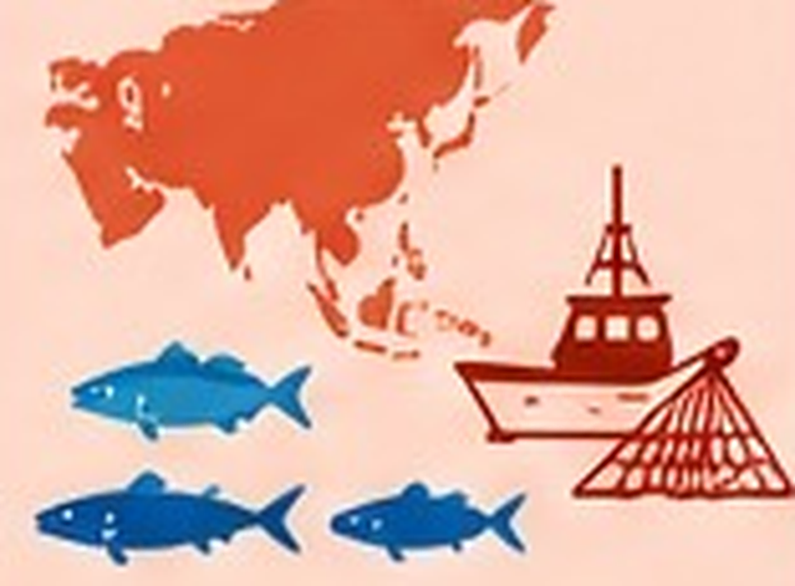

:::::: {.column-screen}

```{=html}
<div class="tbx p-asia">
<div class="subnav"><a href="index.qmd">Overview</a><a class="on" href="asia.qmd">Asia</a><a href="africa.qmd">Africa</a><a href="latin-america.qmd">Latin America</a><a href="sids.qmd">SIDS</a><a href="inland-fisheries.qmd">Inland fisheries</a><a href="developed-countries.qmd">Developed countries</a></div><div class="hero" style="--c:#b9684f"><div class="rh"><div><h1>Asia<span class="pill">Draft</span></h1>
<p class="lead" style="margin-bottom:10px"><b>South, Southeast and East Asia</b></p><p class="lead">Asia supplies most of the world's marine wild catch, much of it from multispecies and multigear fleets in the tropics. This page describes the region's fisheries, institutions and data, lists the assessment tools in use with their limits and toolbox options, and gives case studies and training.</p>
<div class="label" style="margin:14px 0 6px">Regional priorities</div><div class="chips"><span class="chip">Multispecies trawl and multigear fleets</span><span class="chip">Fleet overcapacity</span><span class="chip">Tropical demersals</span><span class="chip">Data-poor methods</span></div>
<p style="margin:16px 0 4px;font-size:16.5px"><b>Key partners:</b> SEAFDEC, BOBP-IGO, APFIC</p><p style="margin:0;font-size:16.5px"><b>Linked programmes:</b> EAF-Nansen (Bay of Bengal), BOBLME (GEF), ISLME, YSLME (GEF)</p></div>
<div class="rimg"></div></div></div><div class="band tint" id="context"><h2>Regional context</h2>
<p class="sub">Asia combines the largest fishing fleet in the world with a large share of global marine catch, and most of that catch comes from small-scale and multispecies fisheries.</p>
<div class="sixs">
<div class="sn" style="--c:#b9684f"><b>about 38 million t</b><span>Average yearly marine wild-capture landings in the region since the mid-1990s.<sup class="cite"><a href="../training/index.qmd#src1">1</a></sup></span></div>
<div class="sn" style="--c:#b9684f"><b>63% of marine capture</b><span>Asia's share of global marine capture production in SOFIA 2026. China, Indonesia, India, Viet Nam and Japan are the top five producers.<sup class="cite"><a href="../training/index.qmd#src16">16</a>, <a href="../training/index.qmd#src17">17</a></sup></span></div>
<div class="sn" style="--c:#b9684f"><b>71% of the world fleet</b><span>Asia hosts 71% of fishing vessels worldwide and 80% of motorised vessels (2022).<sup class="cite"><a href="../training/index.qmd#src3">3</a></sup></span></div>
<div class="sn" style="--c:#b9684f"><b>85% of workers</b><span>Asia has 85% of the 61.8 million people employed in the primary sector of fisheries and aquaculture.<sup class="cite"><a href="../training/index.qmd#src3">3</a></sup></span></div>
<div class="sn" style="--c:#b9684f"><b>1.77 million vessels</b><span>In the South China Sea region, about 86% of them small-scale (2012 report; numbers have changed since).<sup class="cite"><a href="../training/index.qmd#src5">5</a></sup></span></div>
<div class="sn" style="--c:#b9684f"><b>32% reported as "nei"</b><span>Of regional production in 2010, only reported in broad "not elsewhere included" categories, which hides effects of overfishing on juveniles of higher-value species.<sup class="cite"><a href="../training/index.qmd#src5">5</a></sup></span></div></div>
</div><div class="band" id="stocks"><h2>Fisheries and stocks at a glance</h2>
<p class="sub">How many stocks are tracked, how well they are assessed, and how many are fished sustainably. FAO reports these figures by fishing area, using the tiers of the State of Stocks Index (SoSI). Choose an area to view its figures.</p>
<div class="seg" id="areaseg"><button class="on" data-a="a57">Eastern Indian Ocean (Area 57)</button><button data-a="a71">Western Central Pacific (Area 71)</button></div>
<div class="stg" style="grid-template-columns:1fr"><div><div class="pnl on" id="a57"><div class="scc"><h4>Eastern Indian Ocean (FAO Area 57)</h4><div class="big">318 stocks</div><div class="sm2">Bay of Bengal and Andaman Sea coasts, from Bangladesh and India to Indonesia and Australia.<sup class="cite"><a href="../training/index.qmd#src1">1</a></sup></div>
<div class="row2"><div class="lb"><span>Stocks by tier and status</span></div><div style="display:flex;flex-wrap:wrap;gap:18px 28px;align-items:flex-end;margin:6px 0 4px"><div style="min-width:120px"><div style="font-size:22px;font-weight:800;color:#12364d;line-height:1">n = 318</div><div style="font-size:13px;color:#5b6b78;margin-top:4px">65.1% sustainable</div></div><div style="flex:1;min-width:170px"><div style="font-size:13px;font-weight:700;color:#12364d">Tier 1 <span style="font-weight:400;color:#5b6b78">Analytical assessments</span></div><div style="display:flex;gap:8px;margin-top:6px;font-size:11px;font-weight:700;color:#5b6b78"><div style="width:46px;text-align:center">U</div><div style="width:46px;text-align:center">M</div><div style="width:46px;text-align:center">O</div></div><div style="display:flex;gap:8px;margin-top:2px"><div style="display:flex;align-items:center;justify-content:center;width:46px;height:34px;border-radius:5px;font-weight:700;font-size:14px;background:#8EC8E6;color:#0B3550">53</div><div style="display:flex;align-items:center;justify-content:center;width:46px;height:34px;border-radius:5px;font-weight:700;font-size:14px;background:#1874CD;color:#fff">68</div><div style="display:flex;align-items:center;justify-content:center;width:46px;height:34px;border-radius:5px;font-weight:700;font-size:14px;background:#FFA500;color:#1B2631">70</div></div></div><div style="flex:1;min-width:170px"><div style="font-size:13px;font-weight:700;color:#12364d">Tier 2 <span style="font-weight:400;color:#5b6b78">Catch and effort biomass dynamics</span></div><div style="display:flex;gap:8px;margin-top:6px;font-size:11px;font-weight:700;color:#5b6b78"><div style="width:46px;text-align:center">U</div><div style="width:46px;text-align:center">M</div><div style="width:46px;text-align:center">O</div></div><div style="display:flex;gap:8px;margin-top:2px"><div style="display:flex;align-items:center;justify-content:center;width:46px;height:34px;border-radius:5px;font-weight:700;font-size:14px;border:1px dashed #d5dee5;color:#b8c4cd">&ndash;</div><div style="display:flex;align-items:center;justify-content:center;width:46px;height:34px;border-radius:5px;font-weight:700;font-size:14px;background:#1874CD;color:#fff">64</div><div style="display:flex;align-items:center;justify-content:center;width:46px;height:34px;border-radius:5px;font-weight:700;font-size:14px;background:#FFA500;color:#1B2631">32</div></div></div><div style="flex:1;min-width:170px"><div style="font-size:13px;font-weight:700;color:#12364d">Tier 3 <span style="font-weight:400;color:#5b6b78">Indicators, catch-only, length-based</span></div><div style="display:flex;gap:8px;margin-top:6px;font-size:11px;font-weight:700;color:#5b6b78"><div style="width:46px;text-align:center">U</div><div style="width:46px;text-align:center">M</div><div style="width:46px;text-align:center">O</div></div><div style="display:flex;gap:8px;margin-top:2px"><div style="display:flex;align-items:center;justify-content:center;width:46px;height:34px;border-radius:5px;font-weight:700;font-size:14px;border:1px dashed #d5dee5;color:#b8c4cd">&ndash;</div><div style="display:flex;align-items:center;justify-content:center;width:46px;height:34px;border-radius:5px;font-weight:700;font-size:14px;background:#1874CD;color:#fff">22</div><div style="display:flex;align-items:center;justify-content:center;width:46px;height:34px;border-radius:5px;font-weight:700;font-size:14px;background:#FFA500;color:#1B2631">9</div></div></div></div></div>
<div class="row2"><div class="lb"><span>How many are fished sustainably</span></div><div class="bar3"><span style="width:65.1%;background:#1874CD" class="">Sustainable 65.1%</span><span style="width:34.9%;background:#FFA500;color:#1B2631" class="">Overfished 34.9%</span></div><div class="cap2">Share of stocks: 53 underfished and 154 maximally sustainably fished; 111 overfished.</div></div>
<div class="row2"><div class="lb"><span>Landings without an assessment</span></div><div class="bar3"><span class="hatch" style="width:100%">Not reported in the sources reviewed</span></div></div></div></div><div class="pnl" id="a71"><div class="scc"><h4>Western Central Pacific (FAO Area 71)</h4><div class="big">265 stocks</div><div class="sm2">South China Sea, Gulf of Thailand and Indonesian, Philippine and Viet Namese waters.<sup class="cite"><a href="../training/index.qmd#src4">4</a></sup></div>
<div class="row2"><div class="lb"><span>Stocks by tier and status</span></div><div style="display:flex;flex-wrap:wrap;gap:18px 28px;align-items:flex-end;margin:6px 0 4px"><div style="min-width:120px"><div style="font-size:22px;font-weight:800;color:#12364d;line-height:1">n = 265</div><div style="font-size:13px;color:#5b6b78;margin-top:4px">55.1% sustainable</div></div><div style="flex:1;min-width:170px"><div style="font-size:13px;font-weight:700;color:#12364d">Tier 1 <span style="font-weight:400;color:#5b6b78">Analytical assessments</span></div><div style="display:flex;gap:8px;margin-top:6px;font-size:11px;font-weight:700;color:#5b6b78"><div style="width:46px;text-align:center">U</div><div style="width:46px;text-align:center">M</div><div style="width:46px;text-align:center">O</div></div><div style="display:flex;gap:8px;margin-top:2px"><div style="display:flex;align-items:center;justify-content:center;width:46px;height:34px;border-radius:5px;font-weight:700;font-size:14px;background:#8EC8E6;color:#0B3550">9</div><div style="display:flex;align-items:center;justify-content:center;width:46px;height:34px;border-radius:5px;font-weight:700;font-size:14px;background:#1874CD;color:#fff">32</div><div style="display:flex;align-items:center;justify-content:center;width:46px;height:34px;border-radius:5px;font-weight:700;font-size:14px;background:#FFA500;color:#1B2631">3</div></div></div><div style="flex:1;min-width:170px"><div style="font-size:13px;font-weight:700;color:#12364d">Tier 2 <span style="font-weight:400;color:#5b6b78">Catch and effort biomass dynamics</span></div><div style="display:flex;gap:8px;margin-top:6px;font-size:11px;font-weight:700;color:#5b6b78"><div style="width:46px;text-align:center">U</div><div style="width:46px;text-align:center">M</div><div style="width:46px;text-align:center">O</div></div><div style="display:flex;gap:8px;margin-top:2px"><div style="display:flex;align-items:center;justify-content:center;width:46px;height:34px;border-radius:5px;font-weight:700;font-size:14px;border:1px dashed #d5dee5;color:#b8c4cd">&ndash;</div><div style="display:flex;align-items:center;justify-content:center;width:46px;height:34px;border-radius:5px;font-weight:700;font-size:14px;background:#1874CD;color:#fff">17</div><div style="display:flex;align-items:center;justify-content:center;width:46px;height:34px;border-radius:5px;font-weight:700;font-size:14px;background:#FFA500;color:#1B2631">26</div></div></div><div style="flex:1;min-width:170px"><div style="font-size:13px;font-weight:700;color:#12364d">Tier 3 <span style="font-weight:400;color:#5b6b78">Indicators, catch-only, length-based</span></div><div style="display:flex;gap:8px;margin-top:6px;font-size:11px;font-weight:700;color:#5b6b78"><div style="width:46px;text-align:center">U</div><div style="width:46px;text-align:center">M</div><div style="width:46px;text-align:center">O</div></div><div style="display:flex;gap:8px;margin-top:2px"><div style="display:flex;align-items:center;justify-content:center;width:46px;height:34px;border-radius:5px;font-weight:700;font-size:14px;border:1px dashed #d5dee5;color:#b8c4cd">&ndash;</div><div style="display:flex;align-items:center;justify-content:center;width:46px;height:34px;border-radius:5px;font-weight:700;font-size:14px;background:#1874CD;color:#fff">88</div><div style="display:flex;align-items:center;justify-content:center;width:46px;height:34px;border-radius:5px;font-weight:700;font-size:14px;background:#FFA500;color:#1B2631">90</div></div></div></div></div>
<div class="row2"><div class="lb"><span>How many are fished sustainably</span></div><div class="bar3"><span style="width:55.1%;background:#1874CD" class="">Sustainable 55.1%</span><span style="width:44.9%;background:#FFA500;color:#1B2631" class="">Overfished 44.9%</span></div><div class="cap2">Share of stocks: 9 underfished and 137 maximally sustainably fished; 119 overfished.</div></div>
<div class="row2"><div class="lb"><span>Landings without an assessment</span></div><div class="bar3"><span style="width:51%;background:#6c7e8c" class="">Assessed landings 51%</span><span style="width:49%;background:#dfe5ea" class="hatch">Not assessed 49%</span></div></div></div></div><div class="key"><span><i style="background:#8EC8E6"></i>U underfished</span><span><i style="background:#1874CD"></i>M maximally sustainably fished</span><span><i style="background:#FFA500"></i>O overfished</span><span><i class="hatch" style="background:repeating-linear-gradient(45deg,#dfe5ea,#dfe5ea 4px,#eef2f5 4px,#eef2f5 8px)"></i>Missing data</span></div></div>
</div>
<p class="src">Stock counts, tiers and status by area from the FAO State of Stocks Index (SoSI), final classification by tier and area. Area descriptions and landings from the Asian assessment review <sup class="cite"><a href="../training/index.qmd#src1">1</a></sup>. The share of stocks under management measures is not reported in the sources reviewed.</p>
<script>(function(){
var b=document.querySelectorAll("#areaseg button");b.forEach(function(x){x.addEventListener("click",function(){b.forEach(function(y){y.classList.remove("on")});x.classList.add("on");document.querySelectorAll(".pnl").forEach(function(p){p.classList.remove("on")});document.getElementById(x.getAttribute("data-a")).classList.add("on")})});
})();</script></div><div class="band tint" id="management"><h2>Management context and reporting layers</h2>
<p class="sub">Each country reports through several layers, from its own agency to regional bodies, tuna commissions and FAO. The layers differ by country, so a country can answer to more than one body for the same species. The network view shows these links by subregion.</p>
<h3 style="font-size:24px;margin:26px 0 0">Network of countries, regional bodies and FAO</h3>
<p class="sub">Choose a subregion to see each country's national agency or institute, the regional bodies and tuna commissions it belongs to, and how this connects to FAO reporting. Where one country is linked to several bodies, it reports through several layers.</p>
<div class="tabs" id="nettabs"><button data-t="all" class="on">All Asia</button><button data-t="east">East Asia</button><button data-t="south">South Asia</button><button data-t="se">Southeast Asia</button></div>
<div class="net"><svg id="netsvg" viewBox="0 0 1100 480" role="img" aria-label="Network of countries, national agencies, regional bodies and FAO"></svg></div>
<p class="src">Memberships from SEAFDEC, BOBP-IGO, IOTC and WCPFC lists.<sup class="cite"><a href="../training/index.qmd#src10">10</a>, <a href="../training/index.qmd#src11">11</a>, <a href="../training/index.qmd#src12">12</a>, <a href="../training/index.qmd#src13">13</a></sup> South Asian agencies from the FIRMS workshop report.<sup class="cite"><a href="../training/index.qmd#src18">18</a></sup> Agencies in italics are unreferenced and need checking with the countries. All countries also report directly to FAO through SDG 14.4.1.</p>
<script>
(function(){
var TBA="To be added";
var C={east:[["China",[],["IOTC","WCPFC"],TBA,0],["Japan",["SEAFDEC"],["IOTC","WCPFC"],TBA,0],["Republic of Korea",[],["IOTC","WCPFC"],TBA,0]],
south:[["Bangladesh",["BOBP-IGO"],["IOTC"],"Dept of Fisheries; BFRI",1],["India",["BOBP-IGO"],["IOTC"],"Dept of Fisheries; FSI; ICAR-CMFRI",1],["Maldives",["BOBP-IGO"],["IOTC"],"Ministry of Fisheries; MMRI",1],["Pakistan",[],["IOTC"],TBA,0],["Sri Lanka",["BOBP-IGO"],["IOTC"],"Ministry of Fisheries; NARA",1]],
se:[["Brunei Darussalam",["SEAFDEC"],[],"Dept of Fisheries",2],["Cambodia",["SEAFDEC"],[],"Fisheries Administration",2],["Indonesia",["SEAFDEC"],["IOTC","WCPFC"],"Ministry of Marine Affairs and Fisheries",1],["Lao PDR",["SEAFDEC"],[],"Dept of Livestock and Fisheries",2],["Malaysia",["SEAFDEC"],["IOTC"],"Dept of Fisheries",2],["Myanmar",["SEAFDEC"],[],"Dept of Fisheries",2],["Philippines",["SEAFDEC"],["IOTC","WCPFC"],"Bureau of Fisheries and Aquatic Resources",2],["Singapore",["SEAFDEC"],[],"To verify",2],["Thailand",["SEAFDEC"],["IOTC","WCPFC*"],"Dept of Fisheries",2],["Viet Nam",["SEAFDEC"],["WCPFC*"],"Directorate of Fisheries",2]]};
C.all=C.east.concat(C.south,C.se);
var BC={"SEAFDEC":"#2273ae","BOBP-IGO":"#1d8a78","IOTC":"#6b4fa0","WCPFC":"#b7791f"},BODIES=["SEAFDEC","BOBP-IGO","IOTC","WCPFC"];
function esc(t){return t}
function render(t){
 var L=C[t],n=L.length,rowH=t==="all"?33:Math.min(54,Math.max(40,420/n)),H=Math.max(n*rowH+70,300);
 var svg=document.getElementById("netsvg");svg.setAttribute("viewBox","0 0 1100 "+H);
 var used={};L.forEach(function(r){r[1].concat(r[2]).forEach(function(b){used[b.replace("*","")]=1})});
 var bl=BODIES.filter(function(b){return used[b]}),bgap=(H-50)/Math.max(bl.length,1),by={};
 bl.forEach(function(b,i){by[b]=34+bgap*i+bgap/2-24});
 var s="",AX=205,AW=300,BX=650,FX=930;
 L.forEach(function(r,i){var y=34+i*rowH,cy=y+(rowH-8)/2;
  s+='<line x1="180" y1="'+cy+'" x2="'+AX+'" y2="'+cy+'" stroke="#c9b4aa" stroke-width="2"/>';
  r[1].concat(r[2]).forEach(function(b){var bb=b.replace("*",""),dash=b.indexOf("*")>-1?' stroke-dasharray="6 5"':'';
   s+='<path d="M'+(AX+AW)+' '+cy+' C'+(AX+AW+80)+' '+cy+' '+(BX-90)+' '+(by[bb]+24)+' '+BX+' '+(by[bb]+24)+'" fill="none" stroke="'+BC[bb]+'" stroke-width="2.6" opacity=".75"'+dash+'/>';});
 });
 var mid=H/2;
 bl.forEach(function(b){s+='<path d="M'+(BX+150)+' '+(by[b]+24)+' C'+(BX+210)+' '+(by[b]+24)+' '+(FX-70)+' '+mid+' '+(FX-6)+' '+mid+'" fill="none" stroke="#7d93a3" stroke-width="5" stroke-linecap="round"/>';});
 s+='<polygon points="'+(FX-8)+','+(mid-10)+' '+(FX+10)+','+mid+' '+(FX-8)+','+(mid+10)+'" fill="#7d93a3"/>';
 L.forEach(function(r,i){var y=34+i*rowH,h=rowH-8,ag=r[4]===0?TBA:r[3],it=r[4]!==1&&r[4]!==undefined?' font-style="italic"':'',col=r[4]===1?'#33444f':'#8a949c';
  s+='<rect x="20" y="'+y+'" width="160" height="'+h+'" rx="8" fill="#fdf8f6" stroke="#b9684f" stroke-width="1.5"/><text x="32" y="'+(y+h/2+5)+'" font-size="14" font-weight="700" fill="#5a3a2e">'+r[0]+'</text>';
  s+='<rect x="'+AX+'" y="'+y+'" width="'+AW+'" height="'+h+'" rx="8" fill="#fff" stroke="#c5d3dd" stroke-width="1.3"/><text x="'+(AX+12)+'" y="'+(y+h/2+4.5)+'" font-size="13.5" fill="'+col+'"'+it+'>'+ag+'</text>';});
 bl.forEach(function(b){s+='<rect x="'+BX+'" y="'+by[b]+'" width="150" height="48" rx="10" fill="'+BC[b]+'"/><text x="'+(BX+75)+'" y="'+(by[b]+29)+'" text-anchor="middle" font-size="15" font-weight="700" fill="#fff">'+b+'</text>';});
 s+='<rect x="'+FX+'" y="'+(mid-60)+'" width="160" height="120" rx="12" fill="#12364d"/><text x="'+(FX+80)+'" y="'+(mid-26)+'" text-anchor="middle" font-size="17" font-weight="800" fill="#fff">FAO</text><text x="'+(FX+80)+'" y="'+(mid-2)+'" text-anchor="middle" font-size="12.5" fill="#cfe0ec">SDG 14.4.1</text><text x="'+(FX+80)+'" y="'+(mid+18)+'" text-anchor="middle" font-size="12.5" fill="#cfe0ec">FIRMS · SOFIA</text><text x="'+(FX+80)+'" y="'+(mid+38)+'" text-anchor="middle" font-size="12" fill="#cfe0ec">State of Stocks Index</text>';
 var hd=function(x,t){return '<text x="'+x+'" y="18" font-size="12" font-weight="700" fill="#7d93a3" letter-spacing="1">'+t+'</text>'};
 s+=hd(20,"COUNTRIES")+hd(AX,"NATIONAL AGENCY OR INSTITUTE")+hd(BX,"REGIONAL AND TUNA BODIES")+hd(FX,"GLOBAL");
 s+='<text x="'+BX+'" y="'+(H-6)+'" font-size="12" fill="#7d93a3">Dashed line: cooperating non-member (WCPFC*)</text>';
 svg.innerHTML=s;
}
var tabs=document.querySelectorAll("#nettabs button");
tabs.forEach(function(b){b.addEventListener("click",function(){tabs.forEach(function(x){x.classList.remove("on")});b.classList.add("on");render(b.getAttribute("data-t"))})});
render("all");
})();
</script></div><div class="band" id="tools"><h2>Tools used in Asia</h2>
<p class="sub">Compiled from the Asian stock assessment review, the APFIC assessment paper and SEAFDEC reports, which describe CPUE standardisation, yield per recruit and ASPIC in SEAFDEC work.<sup class="cite"><a href="../training/index.qmd#src1">1</a>, <a href="../training/index.qmd#src2">2</a>, <a href="../training/index.qmd#src8">8</a></sup> Select a data situation, or the tool or method already in use, to see the other methods used in that situation with their limits and the FAO toolbox tool recommended instead or alongside.</p>
<div class="tsel"><label for="toolsel">Find by data situation or by tool or method</label><select id="toolsel"><optgroup label="Data situation"><option value="g|Catch and effort">Catch and effort</option><option value="g|Catch-only">Catch-only</option><option value="g|Length-based">Length-based</option><option value="g|Exploitation indicators">Exploitation indicators</option><option value="g|Multispecies and ecosystem">Multispecies and ecosystem</option><option value="g|Surveys and CPUE">Surveys and CPUE</option></optgroup><optgroup label="Tool or method"><option value="t|Catch and effort|ASPIC">ASPIC</option><option value="t|Catch and effort|JABBA">JABBA</option><option value="t|Catch-only|sraplus">sraplus</option><option value="t|Catch-only|CMSY">CMSY</option><option value="t|Length-based|LBSPR, LBB">LBSPR, LBB</option><option value="t|Length-based|FiSAT">FiSAT</option><option value="t|Exploitation indicators|Exploitation ratio, F-factor, F-ratio">Exploitation ratio, F-factor, F-ratio</option><option value="t|Multispecies and ecosystem|MMSY, species hub approach">MMSY, species hub approach</option><option value="t|Multispecies and ecosystem|Ecopath with Ecosim">Ecopath with Ecosim</option><option value="t|Multispecies and ecosystem|MERA (MSE)">MERA (MSE)</option><option value="t|Surveys and CPUE|Trawl surveys, standardised CPUE">Trawl surveys, standardised CPUE</option></optgroup></select><span id="toolcount"></span></div>
<table class="tt wide rt" id="tooltab"><tr><th style="width:11%">Data situation</th><th style="width:16%">Tool or method</th><th style="width:17%">What it does</th><th style="width:30%">Caveats and limitations</th><th style="width:26%">Tool recommendation</th></tr><tr data-g="Catch and effort" data-t="ASPIC"><td class="g">Catch and effort</td><td><b>ASPIC</b></td><td>Surplus production model</td><td class="cv">Needs a reliable effort or CPUE series. Sensitive to starting values. Limited treatment of uncertainty.</td><td class="sp rec">Switch to JABBA3. Keep ASPIC as cross-check.</td></tr><tr data-g="Catch and effort" data-t="JABBA"><td class="g">Catch and effort</td><td><b>JABBA</b></td><td>Bayesian surplus production model</td><td class="cv">Needs an index that tracks abundance, and informative priors for data-poor stocks.</td><td class="sp rec">Use JABBA3. Prepare indices with cpueTargeting and JARA.</td></tr><tr data-g="Catch-only" data-t="sraplus"><td class="g">Catch-only</td><td><b>sraplus</b></td><td>Stock reduction analysis from catch (R package)</td><td class="cv">Results are driven by priors on resilience and depletion, so status is indicative only.</td><td class="sp rec">Switch to CMSY+ in JABBA3 and compare.</td></tr><tr data-g="Catch-only" data-t="CMSY"><td class="g">Catch-only</td><td><b>CMSY</b></td><td>Catch-only stock status</td><td class="cv">Prior-driven. Unreliable where catch does not track abundance, for example under changing effort or reporting.</td><td class="sp rec">Use CMSY+ in JABBA3. Add an index through BSM where available.</td></tr><tr data-g="Length-based" data-t="LBSPR, LBB"><td class="g">Length-based</td><td><b>LBSPR, LBB</b></td><td>Spawning potential ratio, relative biomass</td><td class="cv">Assume equilibrium and representative samples. Sensitive to M/K and asymptotic length. Poor fit for multigear catches.</td><td class="sp rec">Switch to FLicc, which includes both. Check data with FishualizeR.</td></tr><tr data-g="Length-based" data-t="FiSAT"><td class="g">Length-based</td><td><b>FiSAT</b></td><td>Length-frequency analysis (FAO-ICLARM)</td><td class="cv">Older software. Growth from length frequencies can be unstable and gives limited uncertainty.</td><td class="sp rec">Use TropFishR for growth and YPR, and FLicc for status.</td></tr><tr data-g="Exploitation indicators" data-t="Exploitation ratio, F-factor, F-ratio"><td class="g">Exploitation indicators</td><td><b>Exploitation ratio, F-factor, F-ratio</b></td><td>Indicators used in Indonesia, Thailand and Bangladesh</td><td class="cv">Depend on mortality estimates. Give no biomass or reference points, so cannot show stock status alone.</td><td class="sp rec">Supplement with FLicc SPR or JABBA3 status.</td></tr><tr data-g="Multispecies and ecosystem" data-t="MMSY, species hub approach"><td class="g">Multispecies and ecosystem</td><td><b>MMSY, species hub approach</b></td><td>Multispecies yield, grouping by trophic level</td><td class="cv">Data-hungry. Rest on assumptions about species interactions.</td><td class="sp rec">Use mmsyFM.</td></tr><tr data-g="Multispecies and ecosystem" data-t="Ecopath with Ecosim"><td class="g">Multispecies and ecosystem</td><td><b>Ecopath with Ecosim</b></td><td>Ecosystem model</td><td class="cv">Needs diet and biomass data. Results depend on model structure, which is hard to validate.</td><td class="sp rec">Keep for context. Supplement with mmsyFM.</td></tr><tr data-g="Multispecies and ecosystem" data-t="MERA (MSE)"><td class="g">Multispecies and ecosystem</td><td><b>MERA (MSE)</b></td><td>Management strategy evaluation used in Indonesia</td><td class="cv">Results depend on the operating model assumed.</td><td class="sp rec">Switch to FLR mse.</td></tr><tr data-g="Surveys and CPUE" data-t="Trawl surveys, standardised CPUE"><td class="g">Surveys and CPUE</td><td><b>Trawl surveys, standardised CPUE</b></td><td>Fishery-independent indices and CPUE standardisation</td><td class="cv">Survey coverage and series length vary. CPUE standardisation needs covariates for targeting and gear changes.</td><td class="sp rec">Use cpueTargeting, JARA and FishualizeR.</td></tr></table>
<p class="note">Caveats are drafted from general stock assessment practice and need review by method experts. The FAO tools are described on <a class="lnk" href="../methods/index.qmd">Assessment methods</a>.</p></div>

<script>(function(){var s=document.getElementById("toolsel"),rows=[].slice.call(document.querySelectorAll("#tooltab tr[data-g]")),c=document.getElementById("toolcount");function go(){var v=s.value.split("|"),g=v[1]||v[0]&&"",t=v[0]=="t"?v[2]:null;if(v[0]=="g")g=v[1];var n=0;rows.forEach(function(r){var on=r.getAttribute("data-g")==g;r.hidden=!on;r.classList.toggle("hl",on&&t!==null&&r.getAttribute("data-t")==t);if(on)n++});c.textContent=n+(n==1?" method":" methods")+" shown for "+g.toLowerCase()}s.addEventListener("change",go);go()})()</script><div class="band" id="data"><h2>Data situation</h2>
<p class="sub">Stock status in the region is mostly reported through FIRMS, SOFIA and SDG 14.4.1 data calls, supplemented by national reports. Many stocks have no formal assessment, so catch-based and weight-of-evidence methods carry much of the load.<sup class="cite"><a href="../training/index.qmd#src4">4</a></sup></p>
<div class="feat"><div class="fh"><h4>Data sources</h4><p>Where stock and catch information for the region comes from, from global databases to national sampling.</p></div><ul><li><b>FIRMS and SDG 14.4.1 data calls.</b> Countries, regional databases and regional bodies report stock status through these channels.<sup class="cite"><a href="../training/index.qmd#src4">4</a>, <a href="../training/index.qmd#src6">6</a></sup></li><li><b>FAO catch statistics.</b> For stocks without national data, FAO estimates status from FishStat catch and effort data.<sup class="cite"><a href="../training/index.qmd#src4">4</a></sup></li><li><b>National landing statistics.</b> Long-running sampling systems record landings by species in some countries, and some countries run regular national assessment cycles.<sup class="cite"><a href="../training/index.qmd#src15">15</a></sup></li><li><b>Logbooks and observers.</b> Industrial fisheries often keep logbooks, while artisanal fisheries rely on land-based collection and research surveys.<sup class="cite"><a href="../training/index.qmd#src15">15</a></sup></li><li><b>Vessel monitoring.</b> Vessel monitoring covers part of the larger fleets and supports effort estimates.<sup class="cite"><a href="../training/index.qmd#src15">15</a></sup></li><li><b>Length sampling.</b> Fishery-dependent length data support length-based methods.<sup class="cite"><a href="../training/index.qmd#src15">15</a></sup></li><li><b>Trawl surveys.</b> Fishery-independent surveys support standardised CPUE.<sup class="cite"><a href="../training/index.qmd#src1">1</a></sup></li><li><b>Emerging sources.</b> Remote sensing and vessel electronic data can inform assessments.<sup class="cite"><a href="../training/index.qmd#src2">2</a></sup></li></ul></div>
<div class="feat"><div class="fh"><h4>Regional monitoring and capacity work</h4><p>Regional programmes and networks that collect data or build assessment capacity across countries, as distinct from the routine data sources in the first tab.</p></div><ul><li><b>SEAFDEC landing surveys.</b> Landing data on sharks and rays are collected at sites in several Southeast Asian countries.<sup class="cite"><a href="../training/index.qmd#src8">8</a></sup></li><li><b>Neritic tuna study.</b> ASEAN member states took part in a population study that included DNA sampling.<sup class="cite"><a href="../training/index.qmd#src8">8</a></sup></li><li><b>BOBSAN.</b> The Bay of Bengal Stock Assessment Network of government-nominated practitioners is coordinated by BOBP-IGO.<sup class="cite"><a href="../training/index.qmd#src14">14</a></sup></li><li><b>BOBSAN priorities.</b> Members prioritised a regional catch and stock-status database, national assessment guidelines aligned with FAO, and documented success stories.<sup class="cite"><a href="../training/index.qmd#src14">14</a></sup></li><li><b>FAO pilot index.</b> FAO has completed proof-of-concept updates of its State of Stocks Index for several areas, including a revised index for Area 57.<sup class="cite"><a href="../training/index.qmd#src2">2</a></sup></li><li><b>SoSI action plan.</b> The 2025 SEAFDEC and FAO workshop produced an action plan to strengthen data collection and reporting.<sup class="cite"><a href="../training/index.qmd#src6">6</a></sup></li></ul></div></div><div class="band tint" id="pathways"><h2>Typical pathways, gaps and research needs</h2>
<p class="sub">Three common data situations in Asian fisheries share the same steps, from understanding the data to running assessments and giving management advice, but differ in what data exist, what works well, and what holds assessment back in that situation. Gaps that affect all three are listed after the cards. Where more than one source exists for a stock, methods can be run side by side and compared before advice is given. These pathways are our proposal for discussion and have not been checked with regional partners.</p>
<div class="dc3"><div class="dc"><div class="dh"><small>Data situation A</small><b>Multispecies trawl with length samples</b></div><div class="dp dav"><h5><span></span>Data available</h5><ul><li>Length samples from landing sites and trawl surveys</li><li>Catch by gear</li><li>Some life-history parameters</li></ul></div><div class="dp gd"><h5><span></span>Done well</h5><ul><li>Length sampling is routine in several national and regional programmes</li><li>Length-based methods need few inputs and give a quick status check</li></ul></div><div class="dp nd2"><h5><span></span>Needs improvement</h5><ul><li>Few species-level samples, and many missing life-history parameters</li><li>Equilibrium assumptions fail for depleted trawl stocks</li><li>Gear-specific length samples are scarce</li></ul></div></div><div class="dc"><div class="dh"><small>Data situation B</small><b>Catch and effort series from logbooks</b></div><div class="dp dav"><h5><span></span>Data available</h5><ul><li>Logbook catch and effort, mostly from industrial fleets</li><li>Long national landing series</li><li>Survey indices in some areas</li></ul></div><div class="dp gd"><h5><span></span>Done well</h5><ul><li>Long landing series support trend analysis</li><li>Surplus production models need only catch and an abundance index</li></ul></div><div class="dp nd2"><h5><span></span>Needs improvement</h5><ul><li>Effort units are inconsistent and catchability drifts with technology</li><li>Series are short, with little species-level catch</li></ul></div></div><div class="dc"><div class="dh"><small>Data situation C</small><b>Catch-only data for many stocks</b></div><div class="dp dav"><h5><span></span>Data available</h5><ul><li>National landings and FAO catch statistics</li><li>Catch series for hundreds of stocks</li></ul></div><div class="dp gd"><h5><span></span>Done well</h5><ul><li>Catch-only methods bring hundreds of stocks into regional reporting</li><li>Results are available quickly for screening</li></ul></div><div class="dp nd2"><h5><span></span>Needs improvement</h5><ul><li>No abundance signal, so results follow priors</li><li>A long, reliable catch history is needed, and an index or lengths for priority stocks</li></ul></div></div></div>
<h3 style="font-size:24px;margin:34px 0 0">Gaps and research needs across all three situations</h3>
<p class="sub">Gaps and limits that the sources reviewed identify for current practice in the region, which feed the discussion of better options on the overview page.</p>
<div class="feat" style="grid-template-columns:1fr;border:0;background:none;margin-top:6px"><ul style="columns:2;padding-left:22px"><li><b>Reporting in English.</b> Recent assessment reports are rarely published in English.<sup class="cite"><a href="../training/index.qmd#src1">1</a></sup></li><li><b>Aggregated catch.</b> A large share of production is reported in nei categories, which hides species composition.<sup class="cite"><a href="../training/index.qmd#src5">5</a></sup></li><li><b>Staff, funding and methods.</b> Staff shortages, limited funding for surveys and non-standard methods hold back assessment and comparison between countries.<sup class="cite"><a href="../training/index.qmd#src14">14</a>, <a href="../training/index.qmd#src15">15</a></sup></li><li><b>Science to management.</b> Links between scientists and managers are weak and assessments are generally weakly linked to management decisions, although data limitation is no reason to avoid management.<sup class="cite"><a href="../training/index.qmd#src1">1</a>, <a href="../training/index.qmd#src14">14</a></sup></li><li><b>Shared stocks.</b> Management of transboundary stocks remains inadequate.<sup class="cite"><a href="../training/index.qmd#src15">15</a></sup></li><li><b>Independent surveys.</b> Fishery-independent surveys are valuable for baselines and as indicators of stock change, and are underused.<sup class="cite"><a href="../training/index.qmd#src2">2</a></sup></li><li><b>Single-species approaches.</b> Rarely adequate for tropical multispecies fisheries, and suited mainly to fisheries where one species is clearly targeted.<sup class="cite"><a href="../training/index.qmd#src1">1</a>, <a href="../training/index.qmd#src14">14</a></sup></li><li><b>Bio-economic modelling.</b> The APFIC workshop identified a need for it to inform management of multispecies, multigear fisheries.<sup class="cite"><a href="../training/index.qmd#src2">2</a></sup></li><li><b>Uncertainty checks.</b> Practitioners need to evaluate priors, model assumptions and sensitivity, especially for data-limited models.<sup class="cite"><a href="../training/index.qmd#src2">2</a></sup></li><li><b>Inland data.</b> Inland catches may be underestimated because many countries struggle to collect data.<sup class="cite"><a href="../training/index.qmd#src3">3</a></sup></li></ul></div></div><div class="band" id="cases"><h2>Case studies from Asia</h2>
<p class="sub">Four cases from the Asian assessment review, in the common case study format. Fields marked "To be added" are not stated in the sources reviewed so far.</p>
<div class="cs"><div class="cb"><div class="ch" style="background:#b9684f"><h4>Blue swimming crab, north-west Sri Lanka</h4><small>Single-species assessment tied to a harvest strategy</small></div><dl><dt>Fishery</dt><dd>Crab fishery in north-west Sri Lanka</dd><dt>Species</dt><dd>Blue swimming crab</dd><dt>How it was managed</dt><dd>Assessment linked to a harvest strategy, which led to effective management<sup class="cite"><a href="../training/index.qmd#src2">2</a></sup></dd><dt>Tools used</dt><dd>Spawning potential ratio (SPR) based assessment, a single-species approach</dd><dt>Data and period</dt><dd><span class="tbd">To be added</span></dd><dt>Result</dt><dd>SPR of 0.37, classed as sustainable<sup class="cite"><a href="../training/index.qmd#src1">1</a></sup></dd><dt>Key lesson</dt><dd>A single-species approach suits a clearly targeted species<sup class="cite"><a href="../training/index.qmd#src1">1</a></sup></dd><dt>Reference</dt><dd>Source <sup class="cite"><a href="../training/index.qmd#src1">1</a></sup></dd><dt>Toolbox page</dt><dd><a class="lnk" href="../select/index.qmd">Method selector</a>; related tool FLicc (LBSPR)</dd></dl></div><div class="cb"><div class="ch" style="background:#b9684f"><h4>Grouper fisheries, Saleh Bay, Indonesia</h4><small>Harvest strategy built by many partners</small></div><dl><dt>Fishery</dt><dd>Grouper fisheries in Saleh Bay</dd><dt>Species</dt><dd>Groupers</dd><dt>How it was managed</dt><dd>Assessment linked to a harvest strategy developed by researchers, government, fishers, industry and NGOs<sup class="cite"><a href="../training/index.qmd#src2">2</a></sup></dd><dt>Tools used</dt><dd><span class="tbd">To be added</span></dd><dt>Data and period</dt><dd><span class="tbd">To be added</span></dd><dt>Result</dt><dd>Effective management action linked to the assessment<sup class="cite"><a href="../training/index.qmd#src1">1</a></sup></dd><dt>Key lesson</dt><dd>Collaboration across researchers, government, fishers, industry and NGOs supported uptake<sup class="cite"><a href="../training/index.qmd#src2">2</a></sup></dd><dt>Reference</dt><dd>Sources <sup class="cite"><a href="../training/index.qmd#src1">1</a>, <a href="../training/index.qmd#src2">2</a></sup></dd><dt>Toolbox page</dt><dd><a class="lnk" href="../advice/index.qmd">Advice and MSE</a></dd></dl></div><div class="cb"><div class="ch" style="background:#b9684f"><h4>Hilsa shad, India and Bangladesh</h4><small>A shared stock assessed in two countries</small></div><dl><dt>Fishery</dt><dd>Hilsa fisheries in India and Bangladesh</dd><dt>Species</dt><dd>Hilsa shad</dd><dt>How it was managed</dt><dd><span class="tbd">To be added</span></dd><dt>Tools used</dt><dd><span class="tbd">To be added</span></dd><dt>Data and period</dt><dd><span class="tbd">To be added</span></dd><dt>Result</dt><dd>Overfished in India (B/Bmsy 0.21); overfishing flagged in Bangladesh (B/Bmsy 0.96)<sup class="cite"><a href="../training/index.qmd#src1">1</a></sup></dd><dt>Key lesson</dt><dd><span class="tbd">To be added</span></dd><dt>Reference</dt><dd>Source <sup class="cite"><a href="../training/index.qmd#src1">1</a></sup></dd><dt>Toolbox page</dt><dd><a class="lnk" href="../select/index.qmd">Method selector</a></dd></dl></div><div class="cb"><div class="ch" style="background:#b9684f"><h4>Andaman and Nicobar Islands, India</h4><small>Catch-only assessment of many stocks</small></div><dl><dt>Fishery</dt><dd>Fisheries of the Andaman and Nicobar Islands</dd><dt>Species</dt><dd>11 stocks</dd><dt>How it was managed</dt><dd><span class="tbd">To be added</span></dd><dt>Tools used</dt><dd>CMSY, a catch-only method</dd><dt>Data and period</dt><dd>Catch series; period to be added</dd><dt>Result</dt><dd>9 stocks sustainable, 2 fully exploited<sup class="cite"><a href="../training/index.qmd#src1">1</a></sup></dd><dt>Key lesson</dt><dd>Catch-only methods can screen many stocks where data are limited<sup class="cite"><a href="../training/index.qmd#src1">1</a></sup></dd><dt>Reference</dt><dd>Source <sup class="cite"><a href="../training/index.qmd#src1">1</a></sup></dd><dt>Toolbox page</dt><dd>CMSY+ in <a class="lnk" href="../methods/index.qmd">Assessment methods</a> (JABBA3)</dd></dl></div></div>
</div><div class="band" id="training"><h2>Workshops and training</h2>
<table class="tt wk"><tr><th style="width:56%">Workshop</th><th style="width:22%">Date</th><th>Materials</th></tr><tr><td><b>SEAFDEC and FAO consultative planning and training workshop on stock assessment, Southeast Asia (online)</b><sup class="cite"><a href="../training/index.qmd#src7">7</a></sup></td><td>9 and 13–17 December 2021</td><td><a class="lnk" href="https://www.seafdec.org/building-human-capacity-on-fish-stock-assessment-in-southeast-asia-towards-sustainable-use-of-fishery-resources/" target="_blank">Materials</a></td></tr><tr><td><b>FAO regional workshop for a network of practitioners, South Asia (Bangkok)</b><sup class="cite"><a href="../training/index.qmd#src15">15</a></sup></td><td>January 2023</td><td><a class="lnk"  target="_blank">Materials</a></td></tr><tr><td><b>BOBSAN Second Regional Dialogue and FAO validation workshop for Area 51 stocks, South Asia (Kochi)</b><sup class="cite"><a href="../training/index.qmd#src14">14</a></sup></td><td>14–20 April 2024</td><td><a class="lnk" href="https://www.bobpigo.org/publications/BOBSAN%20Regional%20Dialogue%20Outcome%20Document.pdf" target="_blank">Materials</a></td></tr><tr><td><b>SEAFDEC and FAO regional workshop on the State of Stocks Index, Southeast Asia (Bangkok)</b><sup class="cite"><a href="../training/index.qmd#src6">6</a></sup></td><td>8–10 September 2025</td><td><a class="lnk" href="https://www.seafdec.org/seafdec-and-fao-co-organize-regional-capacity-building-workshop-to-support-of-faos-state-of-stocks-index-sosi/" target="_blank">Materials</a></td></tr><tr class="phr"><td><b>Placeholder: regional workshop on stock assessment tools, East Asia</b></td><td>15–17 March 2026 (placeholder)</td><td><a class="lnk" >Materials</a></td></tr><tr class="phr"><td><b>Placeholder: national training on JABBA3 and FLicc, South Asia</b></td><td>10–12 February 2026 (placeholder)</td><td><a class="lnk" >Materials</a></td></tr><tr class="phr"><td><b>Placeholder: training on length-based methods, Southeast Asia</b></td><td>5–7 May 2026 (placeholder)</td><td><a class="lnk" >Materials</a></td></tr><tr class="phr"><td><b>Placeholder: upcoming workshop, South Asia</b></td><td>8–10 June 2027 (placeholder)</td><td><a class="lnk" >Materials</a></td></tr><tr class="phr"><td><b>Placeholder: upcoming workshop, Southeast Asia</b></td><td>21–23 September 2027 (placeholder)</td><td><a class="lnk" >Materials</a></td></tr><tr class="phr"><td><b>Placeholder: upcoming workshop, East Asia</b></td><td>12–14 October 2027 (placeholder)</td><td><a class="lnk" >Materials</a></td></tr></table></div><div class="band" id="contact"><div class="ctc"><div><h4>FAO supports its members</h4><p>Members with questions, ideas or feedback, or who would like to request training, a tool or help with a data gap, are welcome to reach out to FAO.</p></div><a href="../contributing.qmd">Contact FAO</a></div></div><script>(function(){function mk(sel,box,cls,lab){var P=document.querySelectorAll(sel);if(!P.length)return;var bar=document.createElement("div");bar.className="tabs2";P.forEach(function(p,i){p.classList.add("tpane");var b=document.createElement("button");b.textContent=lab(p,i);if(i==0){b.classList.add("on");p.classList.add("on")}b.addEventListener("click",function(){bar.querySelectorAll("button").forEach(function(x){x.classList.remove("on")});P.forEach(function(x){x.classList.remove("on")});b.classList.add("on");p.classList.add("on")});bar.appendChild(b)});P[0].parentNode.insertBefore(bar,P[0])}
mk("#data .feat",0,0,function(p){return p.querySelector("h4").textContent});
})();</script>
</div>
```

::::::
