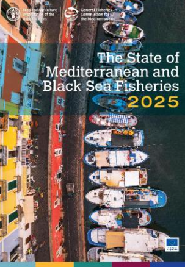

:::::: {.column-screen}

```{=html}
<div class="tbx p-asia">
<div class="subnav"><a href="index.qmd">Overview</a><a href="asia.qmd">Asia</a><a class="on" href="gfcm.qmd">Mediterranean and Black Sea</a><a href="africa.qmd">Africa</a><a href="latin-america.qmd">Latin America</a><a href="sids.qmd">SIDS</a><a href="inland-fisheries.qmd">Inland fisheries</a><a href="developed-countries.qmd">Developed countries</a></div><div class="hero" style="--c:#2a6f97"><div class="rh"><div><h1>Mediterranean and Black Sea<span class="pill">Draft</span></h1>
<p class="lead" style="margin-bottom:10px"><b>GFCM area of application, FAO Area 37</b></p><p class="lead">The Mediterranean and Black Sea combine an old, mostly small-scale fleet with a long record of overexploited demersal and small pelagic stocks. Overexploitation has fallen to its lowest level in a decade, and the General Fisheries Commission for the Mediterranean (GFCM) now gives quantitative advice for its key stocks through a harmonized summary sheet. This page describes the region's fisheries and stocks, the route from assessment to scientific advice, the tools in use with toolbox options, and case studies.</p>
<div class="label" style="margin:14px 0 6px">Regional priorities</div><div class="chips"><span class="chip">Overexploited demersal stocks</span><span class="chip">Small pelagics</span><span class="chip">Multiannual management plans</span><span class="chip">Bycatch and discards</span><span class="chip">Small-scale fisheries</span></div>
<p style="margin:16px 0 4px;font-size:16.5px"><b>Key partners:</b> GFCM (Scientific Advisory Committee, subregional committees, Working Group on the Black Sea), ICCAT for tunas</p><p style="margin:0;font-size:16.5px"><b>Main report:</b> <a class="lnk" href="https://doi.org/10.4060/cd7701en" target="_blank">The State of Mediterranean and Black Sea Fisheries 2025</a> (SoMFi)<sup class="cite"><a href="#g1">1</a></sup></p></div>
<div class="rimg" style="max-width:300px;justify-self:end"><a href="https://doi.org/10.4060/cd7701en" target="_blank" title="Open The State of Mediterranean and Black Sea Fisheries 2025"></a><div style="font-size:13px;text-align:center;margin-top:8px"><a class="lnk" href="https://doi.org/10.4060/cd7701en" target="_blank">Read SoMFi 2025</a></div></div></div></div><div class="band tint" id="context"><h2>Regional context</h2>
<p class="sub">Most figures from SoMFi 2025, with data to 2023.<sup class="cite"><a href="#g1">1</a>, <a href="#g2">2</a></sup></p>
<div class="sixs">
<div class="sn" style="--c:#2a6f97"><b>1.12 million t</b><span>Capture landings in 2023, up 13% from 2022.<sup class="cite"><a href="#g1">1</a></sup></span></div>
<div class="sn" style="--c:#2a6f97"><b>83 075 vessels</b><span>Average age over 35 years. Small-scale vessels are about 81% of the fleet but take 13% of landings.<sup class="cite"><a href="#g1">1</a></sup></span></div>
<div class="sn" style="--c:#2a6f97"><b>63% of landings</b><span>From purse seiners and pelagic trawlers, which are 5.2% of the fleet.<sup class="cite"><a href="#g1">1</a></sup></span></div>
<div class="sn" style="--c:#2a6f97"><b>39.5% from the Black Sea</b><span>Landed by about 13% of the fleet, mostly European anchovy.<sup class="cite"><a href="#g1">1</a></sup></span></div>
<div class="sn" style="--c:#2a6f97"><b>750 000 jobs</b><span>Along the capture fisheries value chain, including 197 000 people on board. First-sale value USD 3.1 billion.<sup class="cite"><a href="#g1">1</a></sup></span></div>
<div class="sn" style="--c:#2a6f97"><b>45% from aquaculture</b><span>Marine and brackish aquaculture produced 940 000 t in 2023, over 45% of regional aquatic food production.<sup class="cite"><a href="#g1">1</a>, <a href="#g2">2</a></sup></span></div></div>
</div><div class="band" id="stocks"><h2>Fisheries and stocks at a glance</h2>
<p class="sub">Two complementary views. FAO's State of Stocks Index (SoSI) classifies stocks in Area 37 by tier; the GFCM reports on the stocks with validated assessments.</p>
<div class="stg" style="grid-template-columns:1fr"><div><div class="pnl on" id="a37"><div class="scc"><h4>Mediterranean and Black Sea (FAO Area 37)</h4><div class="big">127 stocks</div><div class="sm2">Western, central and eastern Mediterranean, Adriatic Sea and Black Sea. Landings about 1.2 million t.<sup class="cite"><a href="#g4">4</a></sup></div>
<div class="row2"><div class="lb"><span>Stocks by tier and status (SoSI)</span></div><div style="display:flex;flex-wrap:wrap;gap:18px 28px;align-items:flex-end;margin:6px 0 4px"><div style="min-width:120px"><div style="font-size:22px;font-weight:800;color:#12364d;line-height:1">n = 127</div><div style="font-size:13px;color:#5b6b78;margin-top:4px">45.7% sustainable</div></div><div style="flex:1;min-width:170px"><div style="font-size:13px;font-weight:700;color:#12364d">Tier 1 <span style="font-weight:400;color:#5b6b78">Analytical assessments</span></div><div style="display:flex;gap:8px;margin-top:6px;font-size:11px;font-weight:700;color:#5b6b78"><div style="width:46px;text-align:center">U</div><div style="width:46px;text-align:center">M</div><div style="width:46px;text-align:center">O</div></div><div style="display:flex;gap:8px;margin-top:2px"><div style="display:flex;align-items:center;justify-content:center;width:46px;height:34px;border-radius:5px;font-weight:700;font-size:14px;background:#8EC8E6;color:#0B3550">18</div><div style="display:flex;align-items:center;justify-content:center;width:46px;height:34px;border-radius:5px;font-weight:700;font-size:14px;background:#1874CD;color:#fff">40</div><div style="display:flex;align-items:center;justify-content:center;width:46px;height:34px;border-radius:5px;font-weight:700;font-size:14px;background:#FFA500;color:#1B2631">68</div></div></div><div style="flex:1;min-width:170px"><div style="font-size:13px;font-weight:700;color:#12364d">Tier 2 <span style="font-weight:400;color:#5b6b78">Catch and effort biomass dynamics</span></div><div style="display:flex;gap:8px;margin-top:6px;font-size:11px;font-weight:700;color:#5b6b78"><div style="width:46px;text-align:center">U</div><div style="width:46px;text-align:center">M</div><div style="width:46px;text-align:center">O</div></div><div style="display:flex;gap:8px;margin-top:2px"><div style="display:flex;align-items:center;justify-content:center;width:46px;height:34px;border-radius:5px;font-weight:700;font-size:14px;border:1px dashed #d5dee5;color:#b8c4cd">&ndash;</div><div style="display:flex;align-items:center;justify-content:center;width:46px;height:34px;border-radius:5px;font-weight:700;font-size:14px;border:1px dashed #d5dee5;color:#b8c4cd">&ndash;</div><div style="display:flex;align-items:center;justify-content:center;width:46px;height:34px;border-radius:5px;font-weight:700;font-size:14px;border:1px dashed #d5dee5;color:#b8c4cd">&ndash;</div></div></div><div style="flex:1;min-width:170px"><div style="font-size:13px;font-weight:700;color:#12364d">Tier 3 <span style="font-weight:400;color:#5b6b78">Indicators, catch-only, length-based</span></div><div style="display:flex;gap:8px;margin-top:6px;font-size:11px;font-weight:700;color:#5b6b78"><div style="width:46px;text-align:center">U</div><div style="width:46px;text-align:center">M</div><div style="width:46px;text-align:center">O</div></div><div style="display:flex;gap:8px;margin-top:2px"><div style="display:flex;align-items:center;justify-content:center;width:46px;height:34px;border-radius:5px;font-weight:700;font-size:14px;border:1px dashed #d5dee5;color:#b8c4cd">&ndash;</div><div style="display:flex;align-items:center;justify-content:center;width:46px;height:34px;border-radius:5px;font-weight:700;font-size:14px;border:1px dashed #d5dee5;color:#b8c4cd">&ndash;</div><div style="display:flex;align-items:center;justify-content:center;width:46px;height:34px;border-radius:5px;font-weight:700;font-size:14px;background:#FFA500;color:#1B2631">1</div></div></div></div></div>
<div class="row2"><div class="lb"><span>How many are fished sustainably (SoSI)</span></div><div class="bar3"><span style="width:45.7%;background:#1874CD">Sustainable 45.7%</span><span style="width:54.3%;background:#FFA500;color:#1B2631">Overfished 54.3%</span></div><div class="cap2">Share of stocks: 18 underfished and 40 maximally sustainably fished; 69 overfished. Nearly all stocks are in Tier 1.</div></div>
<div class="row2"><div class="lb"><span>GFCM validated assessments (SoMFi 2025)</span></div><div class="bar3"><span style="width:48%;background:#1874CD">Not overexploited 48%</span><span style="width:52%;background:#FFA500;color:#1B2631">Overexploited 52%</span></div><div class="cap2">120 assessments in 2023, up from 45 in 2008; 67 give F/F<sub>MSY</sub> and 51 also biomass reference points. Overexploited stocks fell from 87% a decade earlier to 52%, the lowest in the series. F/F<sub>MSY</sub> 0.74 to 1.1; biomass of assessed commercial species up 25% since 2013.<sup class="cite"><a href="#g1">1</a>, <a href="#g2">2</a></sup></div></div>
</div></div></div><div class="key"><span><i style="background:#8EC8E6"></i>U underfished</span><span><i style="background:#1874CD"></i>M maximally sustainably fished</span><span><i style="background:#FFA500"></i>O overfished</span></div></div>
<p class="src">SoSI counts and status from the FAO State of Stocks Index, final classification by tier and area.<sup class="cite"><a href="#g4">4</a></sup> GFCM figures from SoMFi 2025.<sup class="cite"><a href="#g1">1</a></sup> The two views count stocks differently and are not directly comparable.</p></div><div class="band tint" id="management"><h2>From assessment to scientific advice</h2>
<p class="sub">GFCM members report data through the Data Collection Reference Framework. Stock assessments are prepared and reviewed in the working groups on stock assessment, validated by the Scientific Advisory Committee (SAC), and turned into recommendations by the Commission.</p>
<div style="display:flex;flex-wrap:wrap;align-items:stretch;gap:10px;margin:18px 0 6px"><div style="flex:1;min-width:160px;border:1.5px solid #2a6f97;border-radius:12px;padding:12px 14px;background:#fff"><div style="font-weight:800;font-size:15.5px;color:#12364d">National data</div><div style="font-size:14px;color:#4f5f6b;margin-top:4px">Catch, effort, length and survey data reported through the Data Collection Reference Framework</div></div><div style="display:flex;align-items:center;color:#2a6f97;font-size:22px;font-weight:800">&rarr;</div><div style="flex:1;min-width:160px;border:1.5px solid #2a6f97;border-radius:12px;padding:12px 14px;background:#fff"><div style="font-weight:800;font-size:15.5px;color:#12364d">Working groups</div><div style="font-size:14px;color:#4f5f6b;margin-top:4px">Stock assessments of demersal and small pelagic stocks, and the Working Group on the Black Sea</div></div><div style="display:flex;align-items:center;color:#2a6f97;font-size:22px;font-weight:800">&rarr;</div><div style="flex:1;min-width:160px;border:1.5px solid #2a6f97;border-radius:12px;padding:12px 14px;background:#fff"><div style="font-weight:800;font-size:15.5px;color:#12364d">Subregional committees and SAC</div><div style="font-size:14px;color:#4f5f6b;margin-top:4px">Review and validation; scientific advice in a harmonized summary sheet</div></div><div style="display:flex;align-items:center;color:#2a6f97;font-size:22px;font-weight:800">&rarr;</div><div style="flex:1;min-width:160px;border:1.5px solid #2a6f97;border-radius:12px;padding:12px 14px;background:#2a6f97"><div style="font-weight:800;font-size:15.5px;color:#fff">Commission</div><div style="font-size:14px;color:#dbe9f2;margin-top:4px">Recommendations: multiannual management plans, fisheries restricted areas, catch and effort limits</div></div></div>
<p class="src">Since 2013 GFCM members have adopted 11 management plans and established 11 fisheries restricted areas. About 7.3% of the fleet (over 6 000 vessels) is authorized under GFCM plans and measures.<sup class="cite"><a href="#g1">1</a>, <a href="#g2">2</a></sup> Stock status from GFCM assessments also informs FAO reporting through SoSI and SDG 14.4.1.</p>

<h3 style="font-size:24px;margin:34px 0 0">Advice framework with FLRef <span class="pill">Placeholder</span></h3>
<p class="sub">At the request of the SAC (2021 to 2023), a new summary sheet harmonizes how quantitative advice is reported for key stocks, particularly those under management plans. The SAC endorsed it, and it was tested in the working groups on stock assessment in 2024. Functions in the FLR package <a class="lnk" href="../advice/flref.qmd">FLRef</a> produce the sheet's tables and figures from the main assessment platforms.<sup class="cite"><a href="#g5">5</a></sup></p>
<div style="display:flex;flex-wrap:wrap;align-items:stretch;gap:10px;margin:18px 0 6px"><div style="flex:1;min-width:160px;border:1.5px solid #2a6f97;border-radius:12px;padding:12px 14px;background:#fff"><div style="font-weight:800;font-size:15.5px;color:#12364d">Assessment output</div><div style="font-size:14px;color:#4f5f6b;margin-top:4px">a4a, FLSAM, XSA, Stock Synthesis, SPiCT or JABBA</div></div><div style="display:flex;align-items:center;color:#2a6f97;font-size:22px;font-weight:800">&rarr;</div><div style="flex:1;min-width:160px;border:1.5px solid #2a6f97;border-radius:12px;padding:12px 14px;background:#fff"><div style="font-weight:800;font-size:15.5px;color:#12364d">FLRef</div><div style="font-size:14px;color:#4f5f6b;margin-top:4px">Converts the output to a stock object with reference points</div></div><div style="display:flex;align-items:center;color:#2a6f97;font-size:22px;font-weight:800">&rarr;</div><div style="flex:1;min-width:160px;border:1.5px solid #2a6f97;border-radius:12px;padding:12px 14px;background:#fff"><div style="font-weight:800;font-size:15.5px;color:#12364d">Status with uncertainty</div><div style="font-size:14px;color:#4f5f6b;margin-top:4px">Time series of recruitment, SSB, F and catch, or B/B<sub>target</sub> and F/F<sub>target</sub></div></div><div style="display:flex;align-items:center;color:#2a6f97;font-size:22px;font-weight:800">&rarr;</div><div style="flex:1;min-width:160px;border:1.5px solid #2a6f97;border-radius:12px;padding:12px 14px;background:#fff"><div style="font-weight:800;font-size:15.5px;color:#12364d">Fishing opportunities</div><div style="font-size:14px;color:#4f5f6b;margin-top:4px">F-based short-, medium- and long-term forecasts, aligned with the management plan</div></div><div style="display:flex;align-items:center;color:#2a6f97;font-size:22px;font-weight:800">&rarr;</div><div style="flex:1;min-width:160px;border:1.5px solid #2a6f97;border-radius:12px;padding:12px 14px;background:#2a6f97"><div style="font-weight:800;font-size:15.5px;color:#fff">Summary sheet</div><div style="font-size:14px;color:#dbe9f2;margin-top:4px">Advice table, status plots, forecasts, comparison with the previous assessment</div></div></div>
<div class="feat" style="grid-template-columns:1fr;border:0;background:none;margin-top:6px"><ul style="columns:2;padding-left:22px">
<li><b>Advice table.</b> Headline advice with current levels, reference points, quantitative status and the F reduction needed: % F reduction = (1 &minus; 1/F<sub>ratio</sub>) &times; 100.<sup class="cite"><a href="#g5">5</a></sup></li>
<li><b>Forecasts.</b> Short-term (intermediate year plus one), medium-term (about five years or to the end of the management plan) and, where rebuilding takes longer, long-term (about two generations).<sup class="cite"><a href="#g5">5</a></sup></li>
<li><b>Comparison and partial F.</b> A plot comparing the update with the previous assessment, and partial fishing mortality by fleet or gear for integrated models such as Stock Synthesis.<sup class="cite"><a href="#g5">5</a></sup></li>
<li><b>Output to the STAR template.</b> CSV files of time series and reference points for the GFCM stock assessment reporting template.<sup class="cite"><a href="#g5">5</a></sup></li>
<li><b>User guides.</b> Worked examples for a4a (European hake GSA 3, red mullet GSA 16), SPiCT (deep-water rose shrimp GSAs 17&ndash;18) and Stock Synthesis (European hake GSAs 17&ndash;18).<sup class="cite"><a href="#g5">5</a></sup></li>
<li><b>Model summary sheets.</b> Examples include European hake in GSAs 12&ndash;16 (Stock Synthesis) and round sardinella in GSAs 26 and 27 (SPiCT).<sup class="cite"><a href="#g6">6</a></sup></li></ul></div>
<p class="note">Placeholder: user guides, example summary sheets and a worked FLRef example are to be added.</p></div><div class="band" id="tools"><h2>Tools used in the Mediterranean and Black Sea</h2>
<p class="sub">Assessment platforms used for GFCM quantitative advice, as listed in the FLRef user guides, with other methods in use.<sup class="cite"><a href="#g5">5</a></sup> Select a data situation or a tool to see its limits and the toolbox option.</p>
<div class="tsel"><label for="toolsel">Find by data situation or by tool or method</label><select id="toolsel"><optgroup label="Data situation"><option value="g|Catch-at-age">Catch-at-age</option><option value="g|Integrated">Integrated</option><option value="g|Catch and index">Catch and index</option><option value="g|Catch-only">Catch-only</option><option value="g|Length-based">Length-based</option><option value="g|Surveys">Surveys</option></optgroup><optgroup label="Tool or method"><option value="t|Catch-at-age|a4a (FLa4a)">a4a (FLa4a)</option><option value="t|Catch-at-age|XSA">XSA</option><option value="t|Catch-at-age|FLSAM (SAM)">FLSAM (SAM)</option><option value="t|Integrated|Stock Synthesis">Stock Synthesis</option><option value="t|Catch and index|SPiCT">SPiCT</option><option value="t|Catch and index|JABBA">JABBA</option><option value="t|Catch-only|CMSY">CMSY</option><option value="t|Length-based|LBSPR, length indicators">LBSPR, length indicators</option><option value="t|Surveys|MEDITS, MEDIAS and Black Sea surveys">MEDITS, MEDIAS and Black Sea surveys</option></optgroup></select><span id="toolcount"></span></div>
<table class="tt wide rt" id="tooltab"><tr><th style="width:11%">Data situation</th><th style="width:16%">Tool or method</th><th style="width:17%">What it does</th><th style="width:30%">Caveats and limitations</th><th style="width:26%">Tool recommendation</th></tr><tr data-g="Catch-at-age" data-t="a4a (FLa4a)"><td class="g">Catch-at-age</td><td><b>a4a (FLa4a)</b></td><td>Statistical catch-at-age model in FLR</td><td class="cv">Needs catch-at-age and survey or CPUE indices. Results depend on the submodels chosen for F, catchability and recruitment.</td><td class="sp rec">Keep. Report through FLRef; check with the model acceptance checklist.</td></tr><tr data-g="Catch-at-age" data-t="XSA"><td class="g">Catch-at-age</td><td><b>XSA</b></td><td>Extended survivors analysis (virtual population analysis)</td><td class="cv">Assumes catch-at-age is known without error. Sensitive to tuning indices and to the shrinkage settings.</td><td class="sp rec">Prefer a4a or SAM where possible; report through FLRef.</td></tr><tr data-g="Catch-at-age" data-t="FLSAM (SAM)"><td class="g">Catch-at-age</td><td><b>FLSAM (SAM)</b></td><td>State-space assessment model</td><td class="cv">Needs catch-at-age and indices. Process and observation variances can be confounded.</td><td class="sp rec">Keep. Report through FLRef.</td></tr><tr data-g="Integrated" data-t="Stock Synthesis"><td class="g">Integrated</td><td><b>Stock Synthesis</b></td><td>Integrated length- and age-structured model, multi-fleet</td><td class="cv">Complex: many settings to agree; diagnostics are essential. Few national scientists run it.</td><td class="sp rec">Keep for key stocks. Review with ss3diags2 and cross-check with JABBA3 and FLicc.</td></tr><tr data-g="Catch and index" data-t="SPiCT"><td class="g">Catch and index</td><td><b>SPiCT</b></td><td>Surplus production model in continuous time</td><td class="cv">Needs an index that tracks abundance. Priors on the shape and process error affect status.</td><td class="sp rec">Keep, following the good practice guidelines. Cross-check with JABBA3.</td></tr><tr data-g="Catch and index" data-t="JABBA"><td class="g">Catch and index</td><td><b>JABBA</b></td><td>Bayesian surplus production model</td><td class="cv">Needs an informative index and priors for data-poor stocks.</td><td class="sp rec">Switch to JABBA3. Prepare indices with cpueTargeting.</td></tr><tr data-g="Catch-only" data-t="CMSY"><td class="g">Catch-only</td><td><b>CMSY</b></td><td>Catch-only stock status</td><td class="cv">Prior-driven; not suitable for validated advice.</td><td class="sp rec">Use CMSY+ in JABBA3 for screening only.</td></tr><tr data-g="Length-based" data-t="LBSPR, length indicators"><td class="g">Length-based</td><td><b>LBSPR, length indicators</b></td><td>Spawning potential ratio and length-based indicators</td><td class="cv">Assume equilibrium and representative samples; sensitive to M/K and asymptotic length.</td><td class="sp rec">Use FLicc, including its length-based indicators.</td></tr><tr data-g="Surveys" data-t="MEDITS, MEDIAS and Black Sea surveys"><td class="g">Surveys</td><td><b>MEDITS, MEDIAS and Black Sea surveys</b></td><td>Trawl and acoustic surveys for demersal and small pelagic stocks</td><td class="cv">Coverage and timing differ between areas and years.</td><td class="sp rec">Use survey indices in JABBA3 and SPiCT; trends with JARA.</td></tr></table>
<p class="note">Caveats are drafted from general stock assessment practice and need review by GFCM working groups. The toolbox tools are described on <a class="lnk" href="../methods/index.qmd">Assessment methods</a>.</p></div>
<script>(function(){var s=document.getElementById("toolsel"),rows=[].slice.call(document.querySelectorAll("#tooltab tr[data-g]")),c=document.getElementById("toolcount");function go(){var v=s.value.split("|"),g=v[0]=="g"?v[1]:v[1],t=v[0]=="t"?v[2]:null;var n=0;rows.forEach(function(r){var on=r.getAttribute("data-g")==g;r.hidden=!on;r.classList.toggle("hl",on&&t!==null&&r.getAttribute("data-t")==t);if(on)n++});c.textContent=n+(n==1?" method":" methods")+" shown for "+g.toLowerCase()}s.addEventListener("change",go);go()})()</script><div class="band" id="data"><h2>Data situation</h2>
<p class="sub">The Mediterranean and Black Sea have more assessed stocks than most regions, but data gaps remain for bycatch, small-scale fisheries and the southern and eastern shores.</p>
<div class="feat"><div class="fh"><h4>Data sources</h4><p>Where stock and catch information comes from.</p></div><ul><li><b>Data Collection Reference Framework.</b> GFCM members report catch, effort, fleet and biological data through it.</li><li><b>Scientific surveys.</b> Bottom trawl surveys for demersal stocks and acoustic surveys for small pelagics support the indices used in assessments.</li><li><b>Small-scale fisheries data.</b> 19 GFCM contracting and cooperating parties had small-scale fisheries data systems in 2025, up from 8 in 2022.<sup class="cite"><a href="#g1">1</a></sup></li><li><b>Stock assessment forms and summary sheets.</b> Each validated assessment is documented in a standard form and, since 2024, the harmonized summary sheet.<sup class="cite"><a href="#g5">5</a></sup></li></ul></div>
<div class="feat"><div class="fh"><h4>Gaps identified in SoMFi 2025</h4><p>Challenges that the report lists for fisheries.</p></div><ul><li><b>Discards.</b> Bottom trawl discards are often 20 to 40% of the catch.<sup class="cite"><a href="#g1">1</a></sup></li><li><b>Vulnerable species.</b> Bycatch hot spots for elasmobranchs and sea turtles in the central and eastern Mediterranean and the Adriatic; cetacean bycatch mainly in Black Sea small-scale fisheries; stronger observer coverage needed.<sup class="cite"><a href="#g1">1</a></sup></li><li><b>Compliance and fleet.</b> Low compliance with measures, an ageing workforce, unequal profitability and energy costs up 32% for industrial fleets.<sup class="cite"><a href="#g1">1</a>, <a href="#g2">2</a></sup></li><li><b>Depleted stocks.</b> Sardine stocks have long been overexploited and still show biomass depletion; European hake recovery varies between subregions.<sup class="cite"><a href="#g2">2</a></sup></li></ul></div></div><div class="band" id="cases"><h2>Case studies from the Mediterranean and Black Sea</h2>
<p class="sub">Four stocks highlighted in SoMFi 2025, in the common case study format. Fields marked "To be added" are not stated in the sources reviewed so far.</p>
<div class="cs">
<div class="cb"><div class="ch" style="background:#2a6f97"><h4>Turbot, Black Sea</h4><small>Recovery under a multiannual management plan</small></div><dl><dt>Species</dt><dd>Turbot</dd><dt>How it was managed</dt><dd>GFCM multiannual management plan for Black Sea turbot</dd><dt>Tools used</dt><dd><span class="tbd">To be added</span></dd><dt>Result</dt><dd>Fishing mortality down 86% and biomass up 310% since 2013<sup class="cite"><a href="#g1">1</a>, <a href="#g2">2</a></sup></dd><dt>Key lesson</dt><dd><span class="tbd">To be added</span></dd><dt>Toolbox page</dt><dd><a class="lnk" href="../advice/index.qmd">Advice and MSE</a></dd></dl></div>
<div class="cb"><div class="ch" style="background:#2a6f97"><h4>Common sole, Adriatic Sea</h4><small>Fast response to reduced fishing</small></div><dl><dt>Species</dt><dd>Common sole</dd><dt>How it was managed</dt><dd>GFCM management measures for the Adriatic</dd><dt>Tools used</dt><dd>Model ensemble (SOL17), reported as ratios to reference points<sup class="cite"><a href="#g5">5</a></sup></dd><dt>Result</dt><dd>Fishing mortality down 42% and biomass up 64% since 2019<sup class="cite"><a href="#g1">1</a>, <a href="#g2">2</a></sup></dd><dt>Key lesson</dt><dd><span class="tbd">To be added</span></dd><dt>Toolbox page</dt><dd><a class="lnk" href="../advice/flref.qmd">FLRef</a></dd></dl></div>
<div class="cb"><div class="ch" style="background:#2a6f97"><h4>European hake, several subregions</h4><small>Key demersal stock with integrated assessments</small></div><dl><dt>Species</dt><dd>European hake</dd><dt>How it was managed</dt><dd>Multiannual management plans; partial fishing mortality by fleet informs effort allocation</dd><dt>Tools used</dt><dd>Stock Synthesis (GSAs 12&ndash;16, 17&ndash;18) and a4a (GSA 3)<sup class="cite"><a href="#g5">5</a>, <a href="#g6">6</a></sup></dd><dt>Result</dt><dd>Fishing mortality down 38% since 2015; modest biomass recovery, variable between subregions<sup class="cite"><a href="#g2">2</a></sup></dd><dt>Key lesson</dt><dd><span class="tbd">To be added</span></dd><dt>Toolbox page</dt><dd><a class="lnk" href="../methods/index.qmd">Assessment methods</a>; ss3diags2 for review</dd></dl></div>
<div class="cb"><div class="ch" style="background:#2a6f97"><h4>Sardine, Mediterranean</h4><small>Long-term overexploitation of a small pelagic</small></div><dl><dt>Species</dt><dd>European sardine</dd><dt>How it was managed</dt><dd><span class="tbd">To be added</span></dd><dt>Tools used</dt><dd><span class="tbd">To be added</span></dd><dt>Result</dt><dd>Long overexploited, with continued biomass depletion<sup class="cite"><a href="#g2">2</a></sup></dd><dt>Key lesson</dt><dd><span class="tbd">To be added</span></dd><dt>Toolbox page</dt><dd><a class="lnk" href="../select/index.qmd">Method selector</a></dd></dl></div>
</div></div><div class="band" id="training"><h2>Workshops and training</h2>
<table class="tt wk"><tr><th style="width:56%">Workshop</th><th style="width:22%">Date</th><th>Materials</th></tr>
<tr><td><b>GFCM working groups on stock assessment: testing the new summary sheet with FLRef</b></td><td>2024</td><td><a class="lnk">Materials</a></td></tr>
<tr class="phr"><td><b>Placeholder: training on FLRef advice outputs for the summary sheet</b></td><td>To be scheduled</td><td><a class="lnk">Materials</a></td></tr>
<tr class="phr"><td><b>Placeholder: training on Stock Synthesis diagnostics with ss3diags2</b></td><td>To be scheduled</td><td><a class="lnk">Materials</a></td></tr>
<tr class="phr"><td><b>Placeholder: training on JABBA3 and FLicc for data-limited stocks</b></td><td>To be scheduled</td><td><a class="lnk">Materials</a></td></tr></table></div>
<div class="band" id="contact"><div class="ctc"><div><h4>FAO supports its members</h4><p>Members with questions, ideas or feedback, or who would like to request training, a tool or help with a data gap, are welcome to reach out to FAO.</p></div><a href="../contributing.qmd">Contact FAO</a></div></div><div class="band" id="sources"><h2>Sources</h2><ol style="font-size:15px;line-height:1.6">
<li id="g1">FAO. 2025. <i>The State of Mediterranean and Black Sea Fisheries 2025.</i> General Fisheries Commission for the Mediterranean. Rome. <a class="lnk" href="https://doi.org/10.4060/cd7701en" target="_blank">https://doi.org/10.4060/cd7701en</a></li>
<li id="g2">GFCM. 2025. News release on SoMFi 2025, 28 November 2025. <a class="lnk" href="https://www.fao.org/gfcm/news/detail/en/c/1754956/" target="_blank">fao.org/gfcm</a></li>
<li id="g3">GFCM. 2025. SoMFi 2025 highlights. <a class="lnk" href="https://www.fao.org/gfcm/publications/somfi/2025/highlights/en" target="_blank">fao.org/gfcm</a></li>
<li id="g4">FAO State of Stocks Index (SoSI): final classification by tier and area, and SOFIA map table for Area 37.</li>
<li id="g5">Winker, H. 2024. User guides for generating GFCM assessment advice output with FLRef: a4a, SPiCT and Stock Synthesis. GFCM working groups on stock assessment (unpublished working documents).</li>
<li id="g6">GFCM. 2024. Model examples of the new summary sheets (European hake GSAs 12&ndash;16; round sardinella GSAs 26 and 27). Working document.</li></ol></div>
</div>
```

::::::
