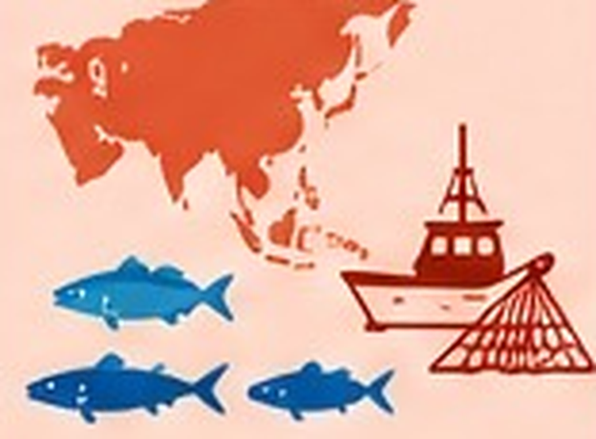
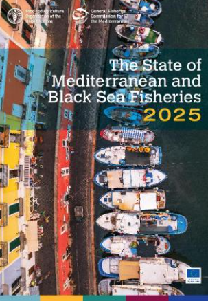
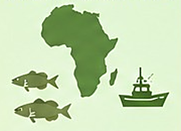
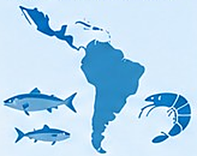
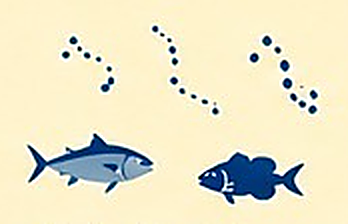
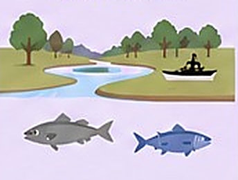
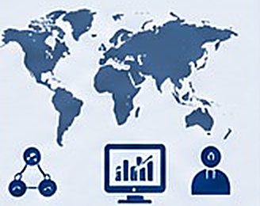

:::::: {.column-screen}

```{=html}
<div class="tbx p-reg">
<div class="subnav"><a class="on" href="index.qmd">Overview</a><a href="asia.qmd">Asia</a><a href="gfcm.qmd">Mediterranean and Black Sea</a><a href="africa.qmd">Africa</a><a href="latin-america.qmd">Latin America</a><a href="sids.qmd">SIDS</a><a href="inland-fisheries.qmd">Inland fisheries</a><a href="developed-countries.qmd">Developed countries</a></div><div class="hero"><h1>Regional hubs<span class="pill">Draft</span></h1>
<p class="lead">Regional hubs bring location-specific examples, case studies and regionally used methods together in one place, so that users can find what is relevant to their own region and fishery.</p>
<div class="jump"><span class="label">On this page</span><a href="#purpose">Purpose</a><a href="#regions">Regions</a><a href="#compare">Regions compared</a><a href="#methods">Regionally specific methods</a><a href="#learning">Learning hub</a></div></div>
<div class="band" id="purpose"><h2>Purpose of the regional hubs</h2>
<p class="sub">Assessment methods are applied under very different conditions across the world. Each hub is written for one region and shows how toolbox methods, and methods already in regional use, are applied to the fisheries found there. The hubs work at three levels, from the regional setting, to the methods used in it, to worked examples of single fisheries.</p>
<div class="pcs">
<div class="pk" style="--c:#2273ae"><div class="pkh"><h4>Regional setting</h4><span>Context</span></div><div class="pkb">
<p>Each hub describes the fisheries, management arrangements and data situation of its region, so users can see conditions similar to their own before looking at any method.</p>
<div class="lab">Each hub gives</div><ul><li>Regional context and key fisheries</li><li>Management context and regional bodies</li><li>Data situation, with sources such as FIRMS and SOFIA</li><li>Typical pathways from data to advice</li></ul></div></div>
<div class="pk" style="--c:#6b4fa0"><div class="pkh"><h4>Regionally specific methods</h4><span>Methods</span></div><div class="pkb">
<p>Methods used mainly in one region are identified and placed beside the toolbox methods that serve a similar purpose, so users can compare them in one place.</p>
<div class="lab">Each hub gives</div><ul><li>A table of tools often used in the region, with toolbox equivalents</li><li>Known limits and research needs</li><li>Training and resources</li></ul>
</div></div>
<div class="pk" style="--c:#1d8a78"><div class="pkh"><h4>Case studies</h4><span>Case studies</span></div><div class="pkb">
<p>Case studies follow one fishery from data to management decision, showing a method working on real data with real limits. All use one format, so fisheries in different regions can be read side by side.</p>
<div class="lab">Benefits</div><ul><li>See methods in practice for a fishery like the user's own</li><li>Follow the route from assessment to scientific advice</li><li>Compare fisheries with similar species, gears or data</li><li>Learn from limits and what was done about them</li></ul>
</div></div></div></div>
<div class="band tint" id="regions"><h2>Regions included</h2>
<p class="sub">The six hubs follow the regional implementation platforms of the Global Stock Assessment Capacity Programme. Each hub has its own page, with regional priorities and partners as set out in the programme.</p>
<div class="rg"><div class="rc" style="--c:#b9684f"><div class="rt"><div><h4><a href="asia.qmd" style="color:inherit;text-decoration:underline">Asia</a></h4><small>South, Southeast and East Asia</small></div></div><div class="rb"><div class="lab">Regional priorities</div><ul><li>Multispecies trawl and multigear fleets</li><li>Fleet overcapacity</li><li>Tropical demersals</li><li>Data-poor methods</li></ul><div class="kp"><b>Key partners:</b> SEAFDEC, BOBP-IGO, APFIC</div><a class="go2" href="asia.qmd">Open the Asia hub →</a></div></div><div class="rc" style="--c:#2a6f97"><div class="rt"><div><h4><a href="gfcm.qmd" style="color:inherit;text-decoration:underline">Mediterranean and Black Sea</a></h4><small>GFCM area of application, FAO Area 37</small></div></div><div class="rb"><div class="lab">Regional priorities</div><ul><li>Overexploited demersal stocks</li><li>Small pelagics</li><li>Multiannual management plans</li><li>Bycatch and discards</li></ul><div class="kp"><b>Key partners:</b> GFCM, ICCAT</div><a class="go2" href="gfcm.qmd">Open the Mediterranean and Black Sea hub →</a></div></div><div class="rc" style="--c:#3f8a3a"><div class="rt"><div><h4><a href="africa.qmd" style="color:inherit;text-decoration:underline">Africa</a></h4><small>West, Central, East and Southern Africa</small></div></div><div class="rb"><div class="lab">Regional priorities</div><ul><li>Shared small pelagic stocks</li><li>Demersal and small-scale fisheries</li><li>Data-poor methods</li></ul><div class="kp"><b>Key partners:</b> WASOP–CECAF, SRFC, FCWC, SWIOFC, BCC</div><a class="go2" href="africa.qmd">Open the Africa hub →</a></div></div><div class="rc" style="--c:#2b7bc4"><div class="rt"><div><h4><a href="latin-america.qmd" style="color:inherit;text-decoration:underline">Latin America</a></h4><small>Pacific coast and Central America</small></div></div><div class="rb"><div class="lab">Regional priorities</div><ul><li>Upwelling pelagics</li><li>Shrimp and demersal multigear fisheries</li><li>Data-poor methods</li></ul><div class="kp"><b>Key partners:</b> WECAFC, OSPESCA, CPPS</div><a class="go2" href="latin-america.qmd">Open the Latin America hub →</a></div></div><div class="rc" style="--c:#b8870f"><div class="rt"><div><h4><a href="sids.qmd" style="color:inherit;text-decoration:underline">SIDS</a></h4><small>Pacific, Caribbean and Indian Ocean</small></div></div><div class="rb"><div class="lab">Regional priorities</div><ul><li>Reef and coastal multispecies stocks</li><li>EEZ tuna linkages</li><li>Very small national teams</li><li>Data-poor methods</li></ul><div class="kp"><b>Key partners:</b> SPC, FFA, CRFM, WECAFC, Indian Ocean Tuna Commission, IORA</div><a class="go2" href="sids.qmd">Open the SIDS hub →</a></div></div><div class="rc" style="--c:#6b4fa0"><div class="rt"><div><h4><a href="inland-fisheries.qmd" style="color:inherit;text-decoration:underline">Inland fisheries</a></h4><small>Lakes, rivers and reservoirs</small></div></div><div class="rb"><div class="lab">Regional priorities</div><ul><li>Inland fish stocks</li><li>Transboundary stocks</li><li>Data-limited methods</li></ul><div class="kp"><b>Key partners:</b> Regional bodies, river basin organizations and national institutions (e.g. LVFO, LTA, Nile, Niger, Mekong)</div><a class="go2" href="inland-fisheries.qmd">Open the Inland fisheries hub →</a></div></div><div class="rc" style="--c:#4a649c"><div class="rt"><div><h4><a href="developed-countries.qmd" style="color:inherit;text-decoration:underline">Developed countries</a></h4><small>Partner role</small></div></div><div class="rb"><div class="lab">Regional priorities</div><ul><li>Method partners and peer review</li><li>Twinning and mentoring</li><li>Mixed-fishery advice experience</li></ul><div class="kp"><b>Key partners:</b> ICES, NOAA, IMR Norway and other national laboratories</div><a class="go2" href="developed-countries.qmd">Open the Developed countries hub →</a></div></div></div></div>
<div class="band" id="compare"><h2>Regions compared</h2>
<p class="sub">Hub boundaries follow the programme's regional implementation platforms. The table shows the areas and countries each hub covers, and the fisheries, gears and institutions found there, so users can decide where to start and which other hubs hold similar examples.</p>
<table class="tt cmp"><tr><th style="width:130px">Region</th><th style="width:30%">Areas and countries</th><th>Dominant fisheries</th><th>Dominant gears</th><th>Main regional bodies</th></tr><tr><td class="g"><a class="lnk" href="asia.qmd"><b style="font-size:17px">Asia</b></a></td><td><b>South Asia:</b> Bangladesh, India, Maldives, Pakistan, Sri Lanka; <b>Southeast Asia:</b> Brunei Darussalam, Cambodia, Indonesia, Lao PDR, Malaysia, Myanmar, Philippines, Singapore, Thailand, Viet Nam; <b>East Asia:</b> China, Japan, Republic of Korea <span class="tbd">(to be confirmed)</span></td><td>Multispecies trawl and multigear fisheries; tropical demersals; small-scale fisheries</td><td>Trawl, purse seine, other nets, handline<sup class="cite"><a href="#src5">5</a></sup></td><td>SEAFDEC, BOBP-IGO, APFIC</td></tr><tr><td class="g"><a class="lnk" href="africa.qmd"><b style="font-size:17px">Africa</b></a></td><td><b>West Africa:</b> <span class="tbd">to be confirmed</span>; <b>Central Africa:</b> <span class="tbd">to be confirmed</span>; <b>East Africa:</b> <span class="tbd">to be confirmed</span>; <b>Southern Africa:</b> <span class="tbd">to be confirmed</span></td><td>Small pelagics; demersal and small-scale fisheries</td><td><span class="tbd">To be added</span></td><td>WASOP–CECAF, SRFC, FCWC, SWIOFC, BCC</td></tr><tr><td class="g"><a class="lnk" href="latin-america.qmd"><b style="font-size:17px">Latin America</b></a></td><td><b>Pacific coast:</b> <span class="tbd">to be confirmed</span>; <b>Central America:</b> <span class="tbd">to be confirmed</span></td><td>Upwelling pelagics; shrimp and demersal fisheries</td><td>Multigear fleets (shrimp and demersal)</td><td>WECAFC, OSPESCA, CPPS</td></tr><tr><td class="g"><a class="lnk" href="sids.qmd"><b style="font-size:17px">SIDS</b></a></td><td><b>Pacific:</b> <span class="tbd">to be confirmed</span>; <b>Caribbean:</b> <span class="tbd">to be confirmed</span>; <b>Indian Ocean:</b> <span class="tbd">to be confirmed</span></td><td>Reef and coastal multispecies fisheries; tuna fisheries</td><td><span class="tbd">To be added</span></td><td>SPC, FFA, CRFM, WECAFC, Indian Ocean Tuna Commission, IORA</td></tr><tr><td class="g"><a class="lnk" href="inland-fisheries.qmd"><b style="font-size:17px">Inland fisheries</b></a></td><td><b>Lakes:</b> <span class="tbd">to be confirmed</span>; <b>Rivers:</b> <span class="tbd">to be confirmed</span>; <b>Reservoirs:</b> <span class="tbd">to be confirmed</span></td><td>Fisheries of lakes, rivers and reservoirs</td><td><span class="tbd">To be added</span></td><td>Regional bodies, river basin organizations and national institutions (e.g. LVFO, LTA, Nile, Niger, Mekong)</td></tr><tr><td class="g"><a class="lnk" href="developed-countries.qmd"><b style="font-size:17px">Developed countries</b></a></td><td><b>Partner institutions:</b> <span class="tbd">to be confirmed</span></td><td>Mixed fisheries</td><td><span class="tbd">To be added</span></td><td>ICES, NOAA, IMR Norway and other national laboratories</td></tr></table>
<p class="src">Areas, fisheries and partners from the Global Stock Assessment Capacity Programme figure. Asia countries from the Asian stock assessment review (source 1) and gears from the FAO regional overview (source 5); see the source list on the <a class="lnk" href="asia.qmd#sources">Asia hub</a>). Other regions are to be completed as their hubs are drafted.</p>
<div class="rule"><b>Proposed rule, to be agreed:</b> users start with the hub for the region where the fishery operates. Lakes, rivers and reservoirs go to Inland fisheries. Small island states can start with SIDS, and look at the nearest regional hub for similar fleets. Tuna and other shared stocks managed by regional fishery bodies are cross-referenced between hubs.</div></div>
<div class="band tint" id="methods"><h2>Methods used only in specific areas</h2>
<p class="sub">Some assessment methods are used widely in one region and hardly at all elsewhere. The map below shows the choices open to users, and what follows from each.</p>
<div class="why"><div class="mt">Why methods differ by region</div><ul><li><b>Local data systems:</b> what is collected shapes what can be run.</li><li><b>Regional bodies and history:</b> guidance and early projects spread certain methods.</li><li><b>Training and software:</b> methods taught and tools available locally.</li><li><b>Fleet and fishery type:</b> multispecies trawl and single-species fisheries call for different approaches.</li></ul></div>
<div class="flow"><div class="st0"><b>The method in regional use differs from a toolbox method</b><span>There is nothing wrong with this. Tools can be limited, so users choose one of two paths.</span></div><svg class="br" width="1320" height="84" viewBox="0 0 1320 84"><path d="M660 4 C660 50 320 30 320 64" fill="none" stroke="#2e7d4f" stroke-width="8" stroke-linecap="round"/><polygon points="304,62 336,62 320,83" fill="#2e7d4f"/><path d="M660 4 C660 50 1000 30 1000 64" fill="none" stroke="#6b4fa0" stroke-width="8" stroke-linecap="round"/><polygon points="984,62 1016,62 1000,83" fill="#6b4fa0"/></svg><div class="cols2"><div class="path"><div class="ph" style="background:#2e7d4f"><span class="pn">1</span>Keep using the current method</div><div class="pbx"><div class="lab">Reasons to keep</div><ul><li>It suits the data and the question</li><li>Its assumptions hold</li><li>Management already accepts its results</li></ul></div><svg class="br" width="640" height="64" viewBox="0 0 640 64"><path d="M320 3 C320 36 155 24 155 44" fill="none" stroke="#2e7d4f" stroke-width="8" stroke-linecap="round"/><polygon points="139,42 171,42 155,63" fill="#2e7d4f"/><path d="M320 3 C320 36 485 24 485 44" fill="none" stroke="#2e7d4f" stroke-width="8" stroke-linecap="round"/><polygon points="469,42 501,42 485,63" fill="#2e7d4f"/></svg><div class="two2"><div class="out" style="--c:#2e7d4f"><b>1a · Add a tool to expand capacity</b><p>Keep the established method and add a toolbox method alongside it, for stocks or data situations it cannot cover, or for outputs it does not give.</p><a href="../select/index.qmd">Method selector →</a></div><div class="out" style="--c:#2e7d4f"><b>1b · Harmonise results with FAO output</b><p>Align status categories, reference points and reporting formats so regional results can feed SOFIA, FIRMS and SDG 14.4.1 reporting.</p><a href="../framework/index.qmd">Standard of good practice →</a></div></div></div><div class="path"><div class="ph" style="background:#6b4fa0"><span class="pn">2</span>Change methods</div><div class="pbx"><div class="lab">Reasons to change</div><ul><li>Assumptions are violated</li><li>Results cannot be compared across stocks or regions</li><li>Advice needs reference points or uncertainty the method lacks</li><li>The tool is no longer maintained</li></ul></div><svg class="av" width="60" height="50" viewBox="0 0 60 50"><line x1="30" y1="2" x2="30" y2="34" stroke="#6b4fa0" stroke-width="8" stroke-linecap="round"/><polygon points="14,32 46,32 30,49" fill="#6b4fa0"/></svg><div class="steps"><div class="mt" style="text-align:center">Path to changing tools</div><div class="stp"><span class="sn2">1</span><div><b>Compare on the same data</b><p>Run the established and the new method on one dataset.</p></div><a href="../select/index.qmd">Method selector →</a></div><svg class="av" width="60" height="38" viewBox="0 0 60 38"><line x1="30" y1="2" x2="30" y2="22" stroke="#6b4fa0" stroke-width="8" stroke-linecap="round"/><polygon points="14,20 46,20 30,37" fill="#6b4fa0"/></svg><div class="stp"><span class="sn2">2</span><div><b>Test by simulation</b><p>Check how each method performs when the true dynamics are known.</p></div><a href="../advice/index.qmd">Advice and MSE →</a></div><svg class="av" width="60" height="38" viewBox="0 0 60 38"><line x1="30" y1="2" x2="30" y2="22" stroke="#6b4fa0" stroke-width="8" stroke-linecap="round"/><polygon points="14,20 46,20 30,37" fill="#6b4fa0"/></svg><div class="stp"><span class="sn2">3</span><div><b>Train the team</b><p>FAO-hosted workshops show users how to run the new tool.</p></div><a href="../training/index.qmd">Request training →</a></div><svg class="av" width="60" height="38" viewBox="0 0 60 38"><line x1="30" y1="2" x2="30" y2="22" stroke="#6b4fa0" stroke-width="8" stroke-linecap="round"/><polygon points="14,20 46,20 30,37" fill="#6b4fa0"/></svg><div class="stp"><span class="sn2">4</span><div><b>Run in parallel</b><p>Report both methods for a period and explain differences.</p></div></div><svg class="av" width="60" height="38" viewBox="0 0 60 38"><line x1="30" y1="2" x2="30" y2="22" stroke="#6b4fa0" stroke-width="8" stroke-linecap="round"/><polygon points="14,20 46,20 30,37" fill="#6b4fa0"/></svg><div class="stp"><span class="sn2">5</span><div><b>Hand over and document</b><p>Record assumptions and caveats, then retire the old method.</p></div></div></div></div></div></div>
<div class="tr2"><div><h4>Training on new tools</h4><p>FAO hosts and organises training workshops to help members learn how to use assessment tools. Users adding or changing tools can request training or look at resources on getting trained.</p></div><div class="tb"><a class="p" href="../training/index.qmd">Request training</a><a class="s" href="../training/index.qmd">Resources for getting trained</a></div></div></div><div class="band" id="learning"><h2>Connection to the cross-regional learning hub</h2>
<p class="sub">The hubs sit inside the programme's cross-regional learning hub, which connects regions and themes for a global impact. Regional methods and case studies feed back into the shared toolbox, and the toolbox methods flow out to every region.</p>
<div class="lh"><div class="mini2" style="--c:#1b4965"><h4>Shared method library and code</h4><p>The toolbox itself, so a method documented once can be used in every region.</p></div><div class="mini2" style="--c:#1b4965"><h4>Joint working groups</h4><p>Groups on shared or similar stocks, linking analysts across regions.</p></div><div class="mini2" style="--c:#1b4965"><h4>Analyst and trainer exchange</h4><p>Staff move between hubs, which spreads regional methods and builds trainer capacity.</p></div><div class="mini2" style="--c:#1b4965"><h4>South–South and triangular cooperation</h4><p>Regions with similar fisheries learn from each other, with support from partners.</p></div></div>
<p class="note" style="margin-top:20px">Users with a regional method or case study to share can use <a class="lnk" href="../contributing.qmd">Contribute</a>. Training material is on <a class="lnk" href="../training/index.qmd">Resources and training</a>.</p></div>
</div>
<script>(function(){var f=document.querySelector('.p-reg #methods .flow');if(!f)return;var w=document.createElement('div');f.parentNode.insertBefore(w,f);w.appendChild(f);w.style.cssText='width:100%;overflow:hidden;position:relative';f.style.width='1320px';f.style.transformOrigin='0 0';function r(){var s=Math.min(1,w.clientWidth/1320);f.style.transform='scale('+s+')';w.style.height=((f.scrollHeight+f.offsetTop+40)*s)+'px'}r();addEventListener('resize',r);addEventListener('load',r);if(window.ResizeObserver){var o=new ResizeObserver(r);o.observe(w);o.observe(f)}})();</script>
```

::::::
