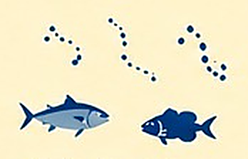

:::::: {.column-screen}

```{=html}
<div class="tbx p-reg">
<div class="subnav"><a href="index.qmd">Overview</a><a href="asia.qmd">Asia</a><a href="africa.qmd">Africa</a><a href="latin-america.qmd">Latin America</a><a class="on" href="sids.qmd">SIDS</a><a href="inland-fisheries.qmd">Inland fisheries</a><a href="developed-countries.qmd">Developed countries</a></div><div class="hero" style="--c:#b8870f"><div class="rh"><div><h1>SIDS<span class="pill">Draft</span></h1>
<p class="lead" style="margin-bottom:10px"><b>Pacific, Caribbean and Indian Ocean</b></p><p class="lead">This hub follows the layout of the Asia hub: tools often used in the region, then case studies. Content for SIDS has not been drafted yet.</p>
<div class="label" style="margin:14px 0 6px">Regional priorities</div><div class="chips"><span class="chip">Reef and coastal multispecies stocks</span><span class="chip">EEZ tuna linkages</span><span class="chip">Very small national teams</span><span class="chip">Data-poor methods</span></div>
<p style="margin:16px 0 4px;font-size:16.5px"><b>Key partners:</b> SPC, FFA, CRFM, WECAFC, Indian Ocean Tuna Commission, IORA</p><p style="margin:0;font-size:16.5px"><b>Linked programmes:</b> CLME+ (GEF); Common Oceans: tuna ABNJ (GEF)</p></div>
<div class="rimg"></div></div></div><div class="band tint"><h2>To follow</h2><p class="sub">Tools often used in the region and example case studies will be added here once the Asia layout is agreed.</p><p><a href="asia.qmd" style="color:var(--accent);font-weight:700;text-decoration:underline">See the Asia hub →</a></p></div>
</div>
```

::::::
