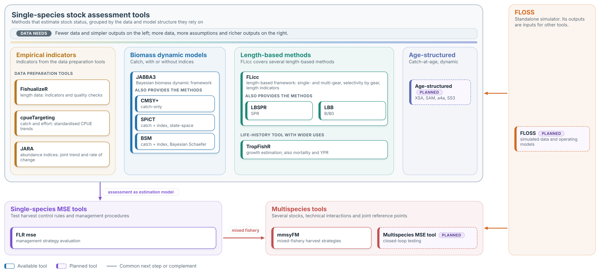

:::::: {.column-screen}

```{=html}
<div class="tbx p-sel">
<div class="head">
<h1>Method selector</h1>
<span class="badge">Draft</span>
<p class="lead">Which assessment methods fit your data, and what to watch out for. Users answer seventeen short questions about their stock, data and purpose, and the selector returns candidate methods, data-preparation steps, advice steps and misuse warnings in one place.</p>
<div class="jump"><span class="label">On this page</span><a href="#what">What it does</a><a href="#methods">Assessment methods</a><a href="#selector">Selector</a><a href="#results">Results</a></div>
</div>

<div class="band" id="what">
<h2>What the method selector does, and why it matters</h2>
<p class="sub">The selector helps users decide which assessment methods suit a stock before investing time in any one of them. It lists methods whose data requirements are met, flags assumptions their situation may violate, and names methods needing data they do not yet have. It is a screening aid in the spirit of FishPath: it narrows options and flags risks, and does not replace diagnostics or working-group review.</p>
<div class="why">
<div class="wc" style="--c:#2273ae"><h4>Matching method to data</h4><p>A method used on data it was not designed for gives confident-looking results that can mislead management: catch-only methods fail on under-reported catch, single-fleet length methods on pooled gears, and production models on hyperstable CPUE.</p></div>
<div class="wc" style="--c:#b7791f"><h4>Warnings, not just a yes or no</h4><p>Each result carries a status. <b>Do not use</b> means a core assumption is violated by the data described, whereas <b>caution</b> means a method can be used with the checks and sensitivity runs listed on its card.</p></div>
<div class="wc" style="--c:#6b4fa0"><h4>A route through the whole toolbox</h4><p>Results link to each method's landing page, suggest data-preparation tools needed beforehand, and point to advice steps such as FLRef and FPAT, so users see what to do next rather than only which model to try.</p></div>
</div>
<div class="how">
<div class="hs"><span class="hn" style="background:#4db3e6">1</span><div><b>Users answer</b><span>Seventeen questions in four groups, with defaults pre-selected so results appear straight away.</span></div></div>
<div class="hs"><span class="hn" style="background:#2b8ac7">2</span><div><b>Requirements are checked</b><span>Each method's data needs, recorded in <code>methods.csv</code>, are compared with the answers.</span></div></div>
<div class="hs"><span class="hn" style="background:#1d7a94">3</span><div><b>Rules are matched</b><span>Misuse rules in <code>misuse_rules.csv</code> raise cautions or stops, so contributors can add a rule without touching code.</span></div></div>
<div class="hs"><span class="hn" style="background:#2a9a84">4</span><div><b>Results are ranked</b><span>Usable methods first, model-based before indicators, then by how much of the available data each one uses.</span></div></div>
</div>
</div>

<div class="band white" id="methods">
<h2>Assessment methods</h2>
<p class="sub">Single-species assessment tools fall into four groups, from empirical indicators needing little data to age-structured models needing the most. Tools can serve several purposes and each sits under its main use. Simulation, single-species MSE and multispecies tools sit alongside, and arrows show common next steps or complements rather than a required order.</p>

<div style="margin-top:18px;display:flex;align-items:center;gap:16px;flex-wrap:wrap"><a href="../methods/index.qmd" style="background:#1b4965;color:#fff;font-weight:700;border-radius:8px;padding:10px 20px;text-decoration:none;font-size:19px">Read more about the individual assessment methods &#8594;</a><span style="font-size:18px;color:#5b6b78">Opens the Assessment methods page, with the FAO tools and the strengths and limits of current practice.</span></div>
</div>
</div>
```

::: {.selband #selector}

## Use the method selector

[Answers are pre-set to sensible defaults, and users change any of them to describe their own stock. Questions about the index switch off when users select "None" for abundance indices.]{.selsub}

```{r}
#| echo: false
#| results: asis
# Embed the registries so the selector also works when the built site is opened from disk (file://)
csv <- function(f) jsonlite::toJSON(paste(readLines(f, encoding = "UTF-8", warn = FALSE), collapse = "\n"), auto_unbox = TRUE)
cat("<script>window.NFIFM_CSV = {methods: ", csv("data/methods.csv"), ", rules: ", csv("data/misuse_rules.csv"), "};</script>\n", sep = "")
```

```{=html}
<div class="seltool"><div class="selbanner"><div class="selic"><svg width="28" height="28" viewBox="0 0 24 24" fill="none" stroke="#fff" stroke-width="2" stroke-linecap="round" stroke-linejoin="round"><path d="M4 6h10M18 6h2M4 12h4M12 12h8M4 18h12M20 18h0"/><circle cx="16" cy="6" r="2"/><circle cx="10" cy="12" r="2"/><circle cx="18" cy="18" r="2"/></svg></div><div class="selbt"><h3>Method selector tool</h3><p>Seventeen questions in four groups. Results update automatically with every answer, so no button needs pressing.</p></div><button type="button" id="sel-reset" class="selreset">Reset to defaults</button></div><div class="selbody"><form id="selector" class="selector-grid" onsubmit="return false">
<fieldset class="selector-q"><legend>Catch and abundance data</legend>
<div class="sel-field" data-q="catch"><div class="sel-label">Catch time series</div>
<label><input type="radio" name="catch" id="q-catch-none" value="none"> No catch series</label>
<label><input type="radio" name="catch" id="q-catch-incomplete" value="incomplete"> Incomplete or under-reported</label>
<label><input type="radio" name="catch" id="q-catch-reliable" value="reliable" checked> Reasonably complete</label>
</div>
<div class="sel-field" data-q="catch_pattern"><div class="sel-label">Catch history</div>
<label><input type="radio" name="catch_pattern" id="q-catch_pattern-full" value="full" checked> ≥ 20 years with rise, peak and decline</label>
<label><input type="radio" name="catch_pattern" id="q-catch_pattern-increasing" value="increasing"> Still increasing (developing fishery)</label>
<label><input type="radio" name="catch_pattern" id="q-catch_pattern-light" value="light"> Lightly exploited throughout</label>
<label><input type="radio" name="catch_pattern" id="q-catch_pattern-short" value="short"> Short (&lt; 20 years) or flat</label>
</div>
<div class="sel-field" data-q="index"><div class="sel-label">Abundance indices</div>
<label><input type="radio" name="index" id="q-index-0" value="0"> None</label>
<label><input type="radio" name="index" id="q-index-1" value="1" checked> One</label>
<label><input type="radio" name="index" id="q-index-2" value="2"> Two or more</label>
</div>
<div class="sel-field" data-q="index_type"><div class="sel-label">Main index type</div>
<label><input type="radio" name="index_type" id="q-index_type-survey" value="survey"> Fishery-independent survey</label>
<label><input type="radio" name="index_type" id="q-index_type-commercial" value="commercial" checked> Commercial CPUE</label>
</div>
<div class="sel-field" data-q="index_length"><div class="sel-label">Index length</div>
<label><input type="radio" name="index_length" id="q-index_length-short" value="short" checked> Short (under ~10 years, or much shorter than catch)</label>
<label><input type="radio" name="index_length" id="q-index_length-long" value="long"> Long, with contrast</label>
</div>
</fieldset>
<fieldset class="selector-q"><legend>Length, age and biology</legend>
<div class="sel-field" data-q="length"><div class="sel-label">Length composition</div>
<label><input type="radio" name="length" id="q-length-none" value="none"> None</label>
<label><input type="radio" name="length" id="q-length-some" value="some" checked> Some years or small samples</label>
<label><input type="radio" name="length" id="q-length-annual" value="annual"> Representative, most years</label>
</div>
<div class="sel-field" data-q="age"><div class="sel-label">Age data</div>
<label><input type="radio" name="age" id="q-age-no" value="no" checked> No</label>
<label><input type="radio" name="age" id="q-age-yes" value="yes"> Yes, catch-at-age</label>
</div>
<div class="sel-field" data-q="lh"><div class="sel-label">Life-history parameters</div>
<label><input type="radio" name="lh" id="q-lh-none" value="none"> None</label>
<label><input type="radio" name="lh" id="q-lh-proxy" value="proxy" checked> Proxies (e.g. FishBase, resilience)</label>
<label><input type="radio" name="lh" id="q-lh-local" value="local"> Local estimates (growth, M, maturity)</label>
</div>
<div class="sel-field" data-q="lifehistory"><div class="sel-label">Life history</div>
<label><input type="radio" name="lifehistory" id="q-lifehistory-short-lived" value="short-lived"> Short-lived (e.g. small pelagics)</label>
<label><input type="radio" name="lifehistory" id="q-lifehistory-medium" value="medium" checked> Medium</label>
<label><input type="radio" name="lifehistory" id="q-lifehistory-long-lived" value="long-lived"> Long-lived</label>
</div>
</fieldset>
<fieldset class="selector-q"><legend>Fishery and purpose</legend>
<div class="sel-field" data-q="gears"><div class="sel-label">Gears</div>
<label><input type="radio" name="gears" id="q-gears-single" value="single"> One main gear</label>
<label><input type="radio" name="gears" id="q-gears-multiple" value="multiple" checked> Several gears with different selectivity</label>
</div>
<div class="sel-field" data-q="species"><div class="sel-label">Fishery</div>
<label><input type="radio" name="species" id="q-species-single" value="single" checked> Single stock</label>
<label><input type="radio" name="species" id="q-species-mixed" value="mixed"> Mixed or multispecies fishery</label>
</div>
<div class="sel-field" data-q="dynamics"><div class="sel-label">Recent F or recruitment</div>
<label><input type="radio" name="dynamics" id="q-dynamics-stable" value="stable" checked> Fairly stable</label>
<label><input type="radio" name="dynamics" id="q-dynamics-changing" value="changing"> Changed strongly</label>
</div>
<div class="sel-field" data-q="capacity"><div class="sel-label">Analyst setup</div>
<label><input type="radio" name="capacity" id="q-capacity-r" value="r" checked> Can run R scripts</label>
<label><input type="radio" name="capacity" id="q-capacity-nocode" value="nocode"> No-code apps only</label>
</div>
<div class="sel-field" data-q="goal"><div class="sel-label">Purpose</div>
<label><input type="radio" name="goal" id="q-goal-status" value="status" checked> Stock status</label>
<label><input type="radio" name="goal" id="q-goal-catch-advice" value="catch advice"> Catch advice</label>
<label><input type="radio" name="goal" id="q-goal-management-options" value="management options"> Compare management options</label>
<label><input type="radio" name="goal" id="q-goal-HCR-testing" value="HCR testing"> Test a harvest control rule</label>
</div>
</fieldset>
<fieldset class="selector-q"><legend>Management context</legend>
<div class="sel-field" data-q="index_behaviour"><div class="sel-label">Does the index track abundance?</div>
<label><input type="radio" name="index_behaviour" id="q-index_behaviour-proportional" value="proportional" checked> Proportional, or no evidence otherwise</label>
<label><input type="radio" name="index_behaviour" id="q-index_behaviour-hyperstable" value="hyperstable"> Hyperstable (catch rates stay high as the stock declines)</label>
<label><input type="radio" name="index_behaviour" id="q-index_behaviour-hyperdepletion" value="hyperdepletion"> Hyperdepleting (declines faster than the stock)</label>
</div>
<div class="sel-field" data-q="effort_creep"><div class="sel-label">Fishing efficiency over time</div>
<label><input type="radio" name="effort_creep" id="q-effort_creep-stable" value="stable" checked> Gear and technology fairly stable</label>
<label><input type="radio" name="effort_creep" id="q-effort_creep-increasing" value="increasing"> Increasing (new gear, engines, electronics; more than ~2% a year)</label>
</div>
<div class="sel-field" data-q="measures"><div class="sel-label">Feasible management measures</div>
<label><input type="radio" name="measures" id="q-measures-tac" value="tac" checked> Catch limits (TAC) can be set and enforced</label>
<label><input type="radio" name="measures" id="q-measures-tae" value="tae"> Effort limits (licences, days, vessels)</label>
<label><input type="radio" name="measures" id="q-measures-technical" value="technical"> Only size limits, gear rules or closures</label>
</div>
<p class="sel-note">After the FPAT App Questions (FAO Technical Paper 737). Catch reporting accuracy is covered by the catch question above.</p>
</fieldset>
</form></div></div>
<h2 id="results">Results</h2>
<div id="sel-summary" class="sel-summary">Loading the method registry…</div>
<div id="sel-fit" class="sel-cards"></div>
<div id="sel-more" class="sel-more"></div>
<h3>Data preparation you will likely need</h3>
<div id="sel-data" class="sel-cards"></div>
<h3>Turning results into advice</h3>
<div id="sel-advice" class="sel-cards"></div>
<h3>Methods that need data you don't have</h3>
<table class="sel-table"><thead><tr><th>Method</th><th>Would also need</th></tr></thead><tbody id="sel-nofit"></tbody></table>
<script>
(function () {
  function parseCSV(text) {
    var rows = [], row = [], f = "", q = false;
    for (var i = 0; i < text.length; i++) {
      var c = text[i];
      if (q) { if (c === '"') { if (text[i + 1] === '"') { f += '"'; i++; } else q = false; } else f += c; }
      else if (c === '"') q = true;
      else if (c === ",") { row.push(f); f = ""; }
      else if (c === "\n") { row.push(f); rows.push(row); row = []; f = ""; }
      else if (c !== "\r") f += c;
    }
    if (f !== "" || row.length) { row.push(f); rows.push(row); }
    var h = rows.shift();
    return rows.filter(function (r) { return r.length === h.length; }).map(function (r) {
      var o = {}; h.forEach(function (k, j) { o[k] = r[j]; }); return o; });
  }
  function esc(s) { return String(s).replace(/[&<>"]/g, function (c) { return {"&": "&amp;", "<": "&lt;", ">": "&gt;", '"': "&quot;"}[c]; }); }
  var lvl = {length: {none: 0, some: 1, annual: 2}, lh: {none: 0, proxy: 1, local: 2}};
  var form = document.getElementById("selector"), methods = [], rules = []; var CAP = 6, expanded = false;
  function answers() {
    var a = {};
    form.querySelectorAll('input[type="radio"]:checked').forEach(function (el) { a[el.name] = el.value; });
    a.index = +a.index;
    form.querySelectorAll('input[name="catch_pattern"]').forEach(function (el) { el.disabled = a.catch === "none"; });
    if (a.catch === "none") a.catch_pattern = "none";
    var noIdx = a.index === 0;
    ["index_type", "index_length", "index_behaviour"].forEach(function (k) {
      form.querySelectorAll('input[name="' + k + '"]').forEach(function (el) { el.disabled = noIdx; });
      if (noIdx) a[k] = "none";
    });
    return a;
  }
  function missing(m, a) {
    var out = [];
    if (m.req_catch === "reliable" && a.catch === "none") out.push("a catch time series");
    if (+m.req_index > a.index) out.push(+m.req_index === 1 ? "an abundance index" : "two or more indices");
    if (lvl.length[m.req_length] > lvl.length[a.length]) out.push(m.req_length === "annual" ? "representative annual length data" : "length composition data");
    if (m.req_age === "yes" && a.age !== "yes") out.push("catch-at-age data");
    if (lvl.lh[m.req_lh] > lvl.lh[a.lh]) out.push(m.req_lh === "local" ? "local life-history estimates" : "life-history proxies");
    if (m.species === "mixed" && a.species !== "mixed") out.push("a mixed or multispecies fishery");
    return out;
  }
  function warns(m, a) {
    return rules.filter(function (r) { return (r.methods === "*" || r.methods.split("|").indexOf(m.id) >= 0) && String(a[r.question]) === r.value; });
  }
  function href(m) { return "../" + m.page.replace(/\.qmd$/, ".html"); }
  function card(m, cls, pill, body) {
    return '<div class="sel-card ' + cls + '"><div class="sel-head"><a href="' + href(m) + '">' + esc(m.name) + '</a><span class="sel-pill">' + pill + '</span></div>' + body + '</div>';
  }
  function update() {
    var a = answers();
    var ass = methods.filter(function (m) { return m.category === "Assessment"; }).map(function (m) {
      var w = warns(m, a);
      if (a.capacity === "nocode" && !m.app) w = w.concat([{severity: "caution", message: "No no-code app yet: running this method needs R. See Training and apps for options."}]);
      if (a.capacity === "nocode" && /unavailable|planned/.test(m.app)) w = w.concat([{severity: "caution", message: "App status: " + m.app + "."}]);
      return {m: m, miss: missing(m, a), w: w, stops: w.filter(function (x) { return x.severity === "stop"; }).length, cautions: w.filter(function (x) { return x.severity === "caution"; }).length};
    });
    function dataUse(m) {
      // weights: indices and age data carry more information than life-history proxies
      return (m.req_catch === "reliable" ? 1 : 0) + 2 * (+m.req_index || 0) + (lvl.length[m.req_length] || 0) + (m.req_age === "yes" ? 2 : 0) + 0.5 * (lvl.lh[m.req_lh] || 0);
    }
    function isInd(m) { return m.class === "Empirical indicators" ? 1 : 0; }
    function gearMiss(m) { return (a.gears === "multiple" && m.gears === "single") ? 1 : 0; }
    // rank: usable first; model-based before indicators; methods using more of the data first; then fewer cautions
    var fit = ass.filter(function (x) { return !x.miss.length; }).sort(function (p, q) {
      return p.stops - q.stops || isInd(p.m) - isInd(q.m) || gearMiss(p.m) - gearMiss(q.m) || dataUse(q.m) - dataUse(p.m) || p.cautions - q.cautions; });
    var nofit = ass.filter(function (x) { return x.miss.length; });
    var ok = fit.filter(function (x) { return !x.stops; }).length;
    document.getElementById("sel-summary").innerHTML = '<span class="sel-count">' + ok + '</span> candidate methods · <span class="sel-count">' + (fit.length - ok) + '</span> not recommended for your data · <span class="sel-count">' + nofit.length + "</span> need data you don't have";
    var shown = expanded ? fit : fit.slice(0, CAP);
    document.getElementById("sel-fit").innerHTML = fit.length ? shown.map(function (x) {
      var cls = x.stops ? "sel-stop" : (x.cautions ? "sel-caution" : "sel-ok");
      var pill = x.stops ? "Do not use" : (x.cautions ? x.cautions + " caution" + (x.cautions > 1 ? "s" : "") : "No flags");
      var body = (isInd(x.m) ? '<div class="sel-meta"><b>Complementary indicator</b></div>' : '') + '<div class="sel-meta">' + esc(x.m.class) + " · " + esc(x.m.application) + '</div><div class="sel-meta"><b>Gives:</b> ' + esc(x.m.outputs) + " · <b>Role:</b> " + esc(x.m.advice_role) + "</div>" + (x.m.app ? '<div class="sel-meta"><b>No-code app:</b> ' + esc(x.m.app) + "</div>" : "");
      if (x.w.length) body += '<ul class="sel-warn">' + x.w.map(function (w) { return "<li><b>" + (w.severity === "stop" ? "Do not use:" : "Caution:") + "</b> " + esc(w.message) + "</li>"; }).join("") + "</ul>";
      return card(x.m, cls, pill, body);
    }).join("") : '<p class="sel-none">No assessment method fits these data. See the table below for what each method would need.</p>';
    document.getElementById("sel-more").innerHTML = fit.length > CAP ? '<span>Showing the ' + shown.length + ' best-ranked of ' + fit.length + ' methods whose data requirements are met.</span><button type="button" id="sel-toggle">' + (expanded ? "Show fewer" : "Show all " + fit.length) + '</button>' : "";
    var data = methods.filter(function (m) { return m.category === "Data and CPUE tools"; }).filter(function (m) {
      return m.id === "dataprep" || (m.id === "cpuetargeting" && a.index > 0 && a.index_type === "commercial") || (m.id === "jara" && (a.index >= 2 || a.catch === "incomplete")) || (m.id === "fishualizer" && a.length !== "none");
    });
    document.getElementById("sel-data").innerHTML = data.length ? data.map(function (m) { return card(m, "sel-data", "Data step", '<div class="sel-meta">' + esc(m.subclass) + " · " + esc(m.application) + "</div>"); }).join("") : '<p class="sel-none">No specific data-preparation tool suggested for these answers.</p>';
    var adv = methods.filter(function (m) { return m.category === "Advice and MSE"; }).filter(function (m) {
      if (m.id === "flref") return fit.length > 0;
      if (m.id === "mmsyfm") return a.species === "mixed";
      if (m.id === "fpat") return a.goal === "management options" || a.goal === "HCR testing" || a.measures !== "tac";
      return a.goal === "HCR testing";
    });
    document.getElementById("sel-advice").innerHTML = adv.length ? adv.map(function (m) {
      var w = warns(m, a).filter(function (r) { return r.methods !== "*"; }), body = '<div class="sel-meta">' + esc(m.outputs) + "</div>" + (m.app ? '<div class="sel-meta"><b>No-code app:</b> ' + esc(m.app) + "</div>" : "");
      if (w.length) body += '<ul class="sel-warn">' + w.map(function (x) { return "<li><b>" + (x.severity === "stop" ? "Do not use:" : "Caution:") + "</b> " + esc(x.message) + "</li>"; }).join("") + "</ul>";
      return card(m, "sel-advice", "Advice step", body); }).join("") : '<p class="sel-none">No candidate assessment yet, so no advice step.</p>';
    document.getElementById("sel-nofit").innerHTML = nofit.map(function (x) { return '<tr><td><a href="' + href(x.m) + '">' + esc(x.m.name) + "</a></td><td>" + esc(x.miss.join(", ")) + "</td></tr>"; }).join("");
  }
  (window.NFIFM_CSV ? Promise.resolve([window.NFIFM_CSV.methods, window.NFIFM_CSV.rules]) :
   Promise.all(["../data/methods.csv", "../data/misuse_rules.csv"].map(function (u) { return fetch(u).then(function (r) { if (!r.ok) throw new Error(u); return r.text(); }); })))
    .then(function (t) { methods = parseCSV(t[0]); rules = parseCSV(t[1]); form.addEventListener("change", update); document.getElementById("sel-more").addEventListener("click", function (e) { if (e.target.id === "sel-toggle") { expanded = !expanded; update(); } }); document.getElementById("sel-reset").addEventListener("click", function () { form.reset(); expanded = false; update(); }); update(); })
    .catch(function () { document.getElementById("sel-summary").textContent = "The method registry could not be loaded. Open the site from a web server (quarto preview or GitHub Pages), not as a local file."; });
})();
</script>
```

:::

::::::
